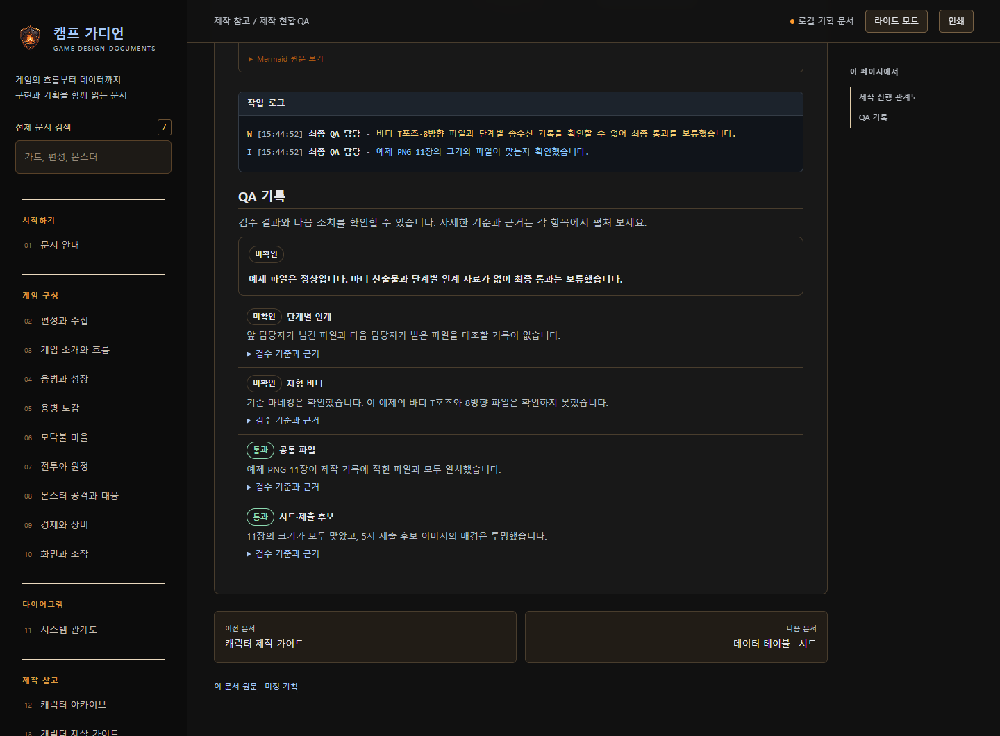

## 작업 결과

제작 현황·QA 화면, 목차, 검색 및 원문 팝업에서 운영 명령을 제거했습니다.

## 변경 내용

### 적용 내용

기존 운영 절차는 제작 담당자용 문서로 옮기고 프로젝트 지침과 에이전트 TOML의 참조를 갱신했습니다.

## 검증

Chrome에서 게시판과 원문 팝업에 운영 내용이 표시되지 않았고 목차와 검색에서도 제거된 것을 확인했습니다. 마네킹 예제 QA 4건을 확인했습니다. 프로젝트 main에 63224677을 푸시했습니다.

## 남은 사항

공개 배포 확인은 별도입니다.

## 작업 시간

- 제안 시간: 4~6분
- 실제로 완료된 시간: 2026-11-21 16:01:34~16:02:38 KST, 약 1분
- XERJ: 미사용 — 로컬 Chrome, 빌드 및 Git으로 확인했습니다.
