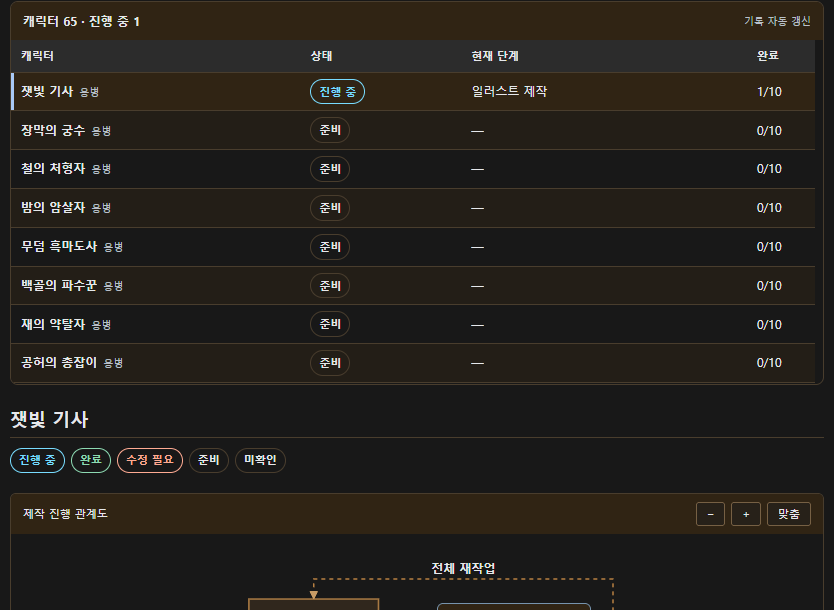

## 작업 결과

캐릭터 65종의 상태, 현재 단계, 완료 수를 한눈에 확인합니다. 목록에서 선택한 캐릭터의 관계도, 작업 로그, QA 기록이 아래에 표시됩니다.

## 변경 내용

### 적용 내용

요청에 따라 전체·부분 실행 버튼을 게시판에서 제거했습니다. 화면은 진행 중 상태를 넣은 검수용 캡처입니다.

## 검증

Chrome에서 65종과 예제 한 줄, 자동 갱신 시 진행 중 캐릭터가 첫 행으로 이동하는 동작, 기존 선택 유지, 키보드로 상세 열기, 예제 QA 4건, 390px에서 목록 가로 넘침이 없음을 확인했습니다. 프로젝트 main에 678a571d를 푸시했습니다.

## 남은 사항

공개 배포와 공개 미디어 접근은 미확인입니다.

## 작업 시간

- 제안 시간: 5~7분
- 실제로 완료된 시간: 2026-11-21 16:03:19~16:05:55 KST, 약 2분 36초
- XERJ: 미사용 — 로컬 서버, Chrome, Git으로 확인했습니다.
