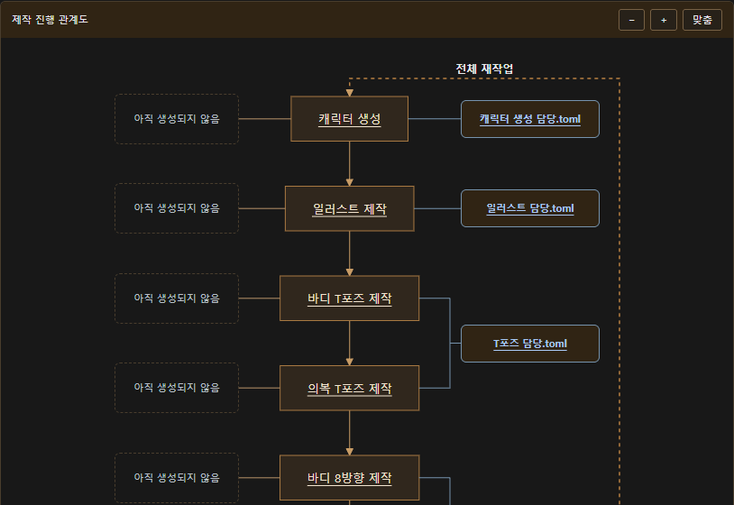

## 작업 결과

모든 단계 옆에 138×56 미리보기 칸을 사용합니다. 결과물이 없는 칸에는 ‘아직 생성되지 않음’을 표시합니다.

## 변경 내용

### 적용 내용

빈 칸은 점선 테두리로 표시합니다. 라이트 및 다크 모드에서 글자가 읽히도록 색상을 적용했습니다.

## 검증

Chrome에서 준비 상태 10칸, 마네킹 예제의 결과 7칸과 빈 자리 3칸, 두 종류의 동일 크기와 다크·라이트 모드 텍스트 색상을 확인했습니다. 프로젝트 main에 94e492d5를 푸시했습니다.

## 남은 사항

공개 보고서 배포는 미확인입니다.

## 작업 시간

- 제안 시간: 4~6분
- 실제로 완료된 시간: 2026-11-21 16:06:37~16:08:02 KST, 약 1분 25초
- XERJ: 미사용 — 로컬 Chrome과 Git으로 확인했습니다.
