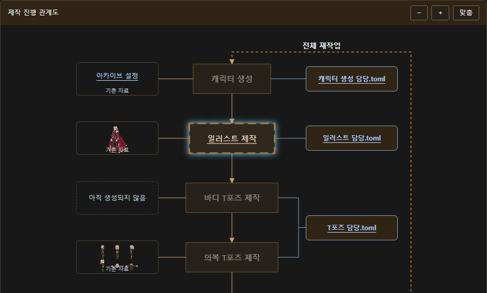

## 작업 결과

진행 중 단계가 없거나 완료된 경우에는 모든 단계가 비활성입니다. 산출물 미리보기를 확인할 수 있습니다.

## 변경 내용

### 적용 내용

비활성 도형의 링크와 키보드 포커스를 제거했습니다. 아래는 검수용 상태를 적용한 실제 Chrome 캡처입니다.

## 검증

Chrome에서 준비 시 10단계 비활성, 진행 시 1단계 강조와 9단계 비활성, 완료 시 10단계 비활성 복귀와 모션 감소 설정을 확인했습니다. 제작 가이드 링크 10개를 확인했고 GIF 연속 프레임 7쌍에서 실제 테두리 움직임을 검증했습니다. main 761be6bb 푸시 완료.

## 남은 사항

공개 배포는 미확인입니다.

## 작업 시간

- 제안 시간: 4~6분
- 실제로 완료된 시간: 2026-11-21 16:16:45~16:18:18 KST, 약 1분 33초
- XERJ: 미사용 — 로컬 Chrome과 Git으로 확인했습니다.
