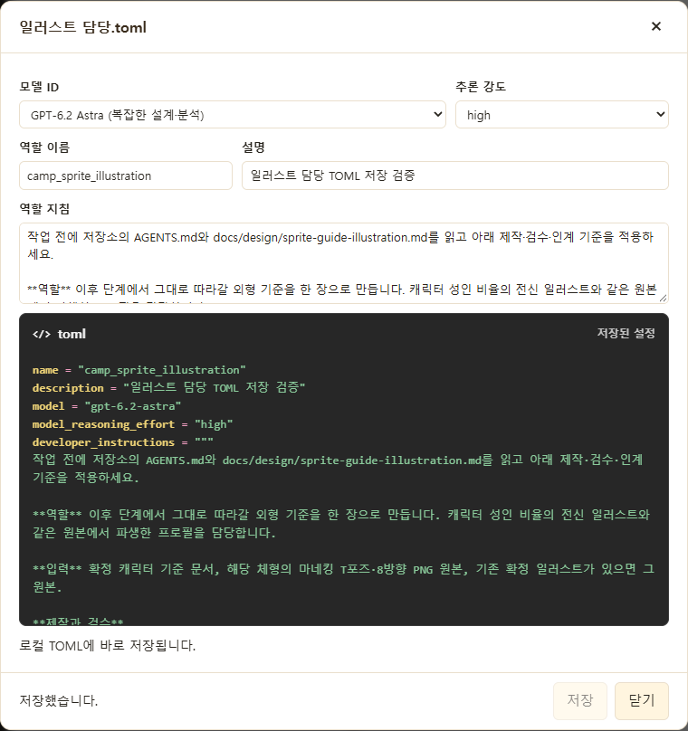

## 작업 결과

## 변경 내용

### 적용 내용

파일 주소에서 저장 기능이 있는 로컬 편집기로 연결합니다. 프로젝트 44e0918f 푸시.

## 검증

실제 파일 주소의 제작 현황에서 일러스트 담당 편집기를 열고 저장 버튼을 확인했습니다. 저장 요청을 검증용 복사본에 보내 디스크 반영을 확인했습니다.

## 남은 사항

로컬 서버가 실행 중이어야 합니다. 중앙 보고서 웹 게시 미확인.

## 작업 시간

- 제안 시간: 4분
- 실제로 완료된 시간: 16:17:21 시작, 16:20:36 검증 및 프로젝트 푸시 완료. 3분 15초 KST.
- XERJ: 미사용 — 코드 검색 근거가 제공되지 않았습니다.
