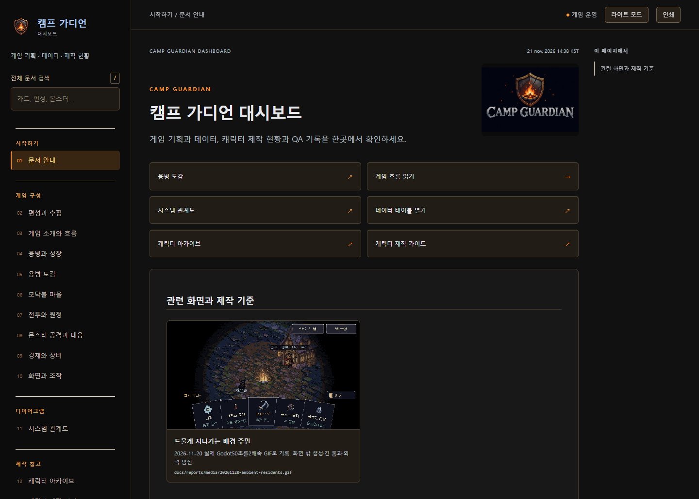
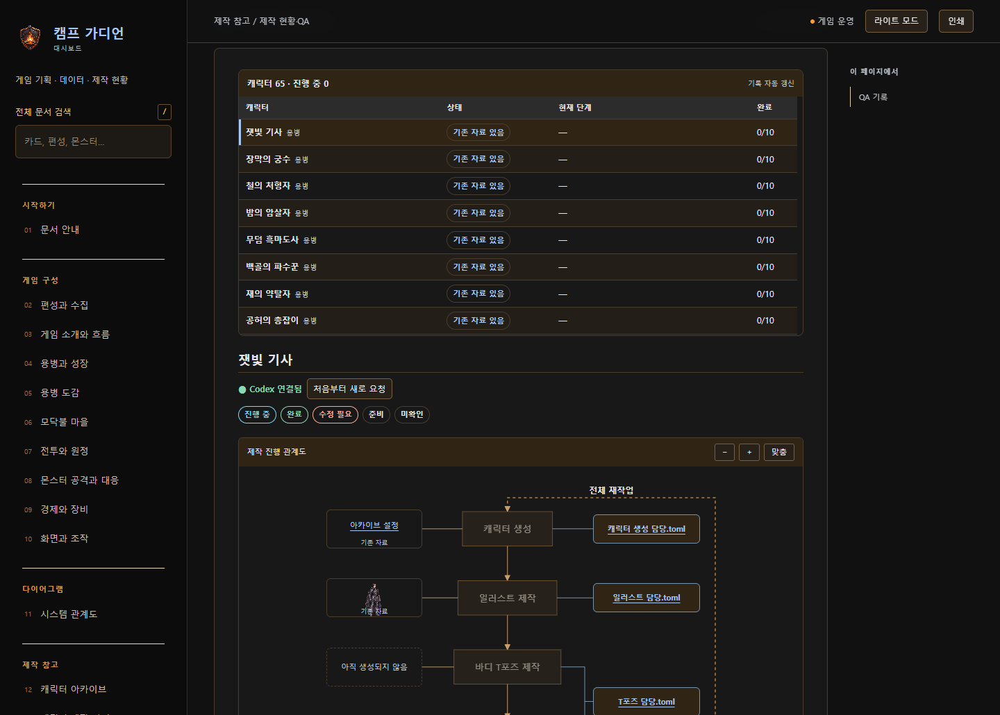

## 작업 결과

사이트 이름과 브라우저 탭을 캠프 가디언 대시보드로 맞췄습니다. 로그인 연결 상태가 확인되면 초록색 ‘● Codex 연결됨’을 표시합니다.

## 변경 내용

### 적용 내용

Claude 선택과 요청 처리를 제거했습니다. 연결되지 않았을 때는 ‘Codex 연결하기’를 표시합니다.

## 검증

Chrome에서 홈과 제작 현황 탭 이름, 사이드바 이름, 실제 Codex 로그인과 초록색 상태 문구를 확인했습니다. 임시 미연결 응답으로 연결 버튼 전환을 검증했고, 기존 Claude 요청은 거부됨을 확인했습니다. 로컬 대시보드 서버를 갱신하고 main 241f3001을 푸시했습니다.

## 남은 사항

공개 배포는 미확인입니다.

## 작업 시간

- 제안 시간: 3~5분
- 실제로 완료된 시간: 2026-11-21 16:19:52~16:22:38 KST, 약 2분 46초
- XERJ: 미사용 — 로컬 Chrome, 실제 Codex 로그인 확인, Git으로 확인했습니다.
