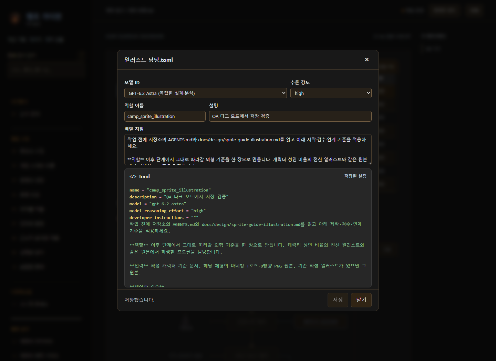

## 작업 결과

## 변경 내용

### 적용 내용

현재 문서 위의 모달 안에서 로컬 편집기를 열고 현재 테마를 전달합니다. 프로젝트 4dc1e383 푸시.

## 검증

Chrome의 file 주소 제작 현황에서 QA의 일러스트 TOML 열기를 실행했습니다. 주소와 문서 인스턴스, 양쪽 다크 테마, 검증용 복사본 저장 및 닫기를 확인했습니다.

## 남은 사항

실행 중인 서버의 응답 헤더 변경은 재시작 시 적용됩니다. 중앙 보고서 웹 게시 미확인.

## 작업 시간

- 제안 시간: 5분
- 실제로 완료된 시간: 16:22:40 시작, 16:26:11 프로젝트 푸시 완료. 3분 31초 KST.
- XERJ: 미사용 — 코드 검색 근거가 제공되지 않았습니다.
