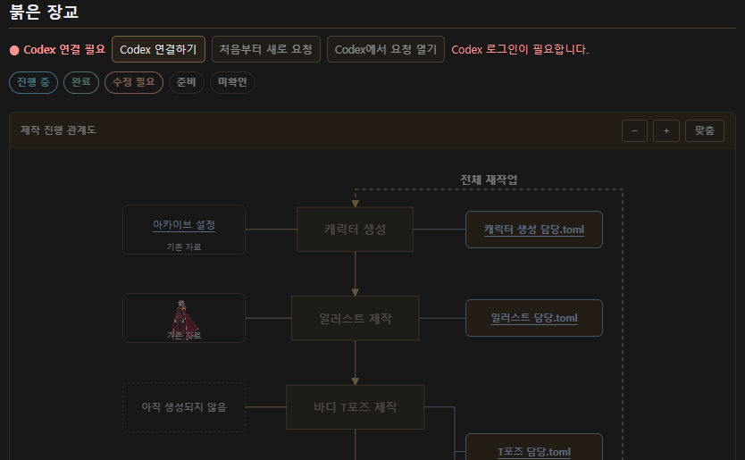

## 작업 결과

미연결이면 ‘● Codex 연결 필요’가 표시되고 관계도, 작업 로그, QA 기록과 제작 버튼의 조작이 잠깁니다. 연결을 확인하면 다시 사용할 수 있습니다.

## 변경 내용

### 적용 내용

연결·실행 실패 문구에 빨간색을 적용했습니다.

## 검증

Chrome에서 미연결 시 두 상세 영역 비활성, 미리보기와 재작업 버튼 동작 차단, 연결 복구 후 활성화, 모의 실행 실패 문구의 빨간색을 확인했습니다. 프로젝트 main 909cfc1c에 푸시했습니다.

## 남은 사항

실제 제작 요청은 실행하지 않았습니다. 공개 보고서 배포는 미확인입니다.

## 작업 시간

- 제안 시간: 4~6분
- 실제로 완료된 시간: 2026-11-21 16:23:59~16:27:19 KST, 약 3분 20초
- XERJ: 미사용 — 로컬 Chrome과 Git으로 확인했습니다.
