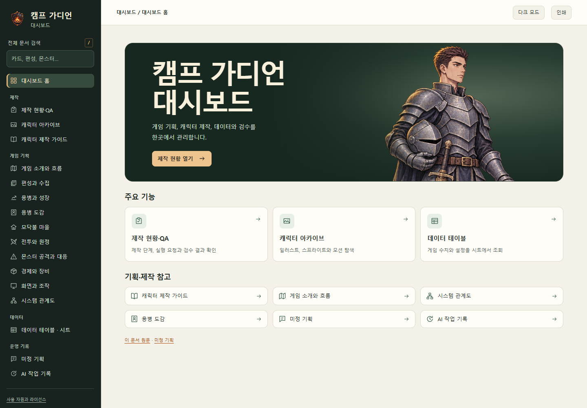
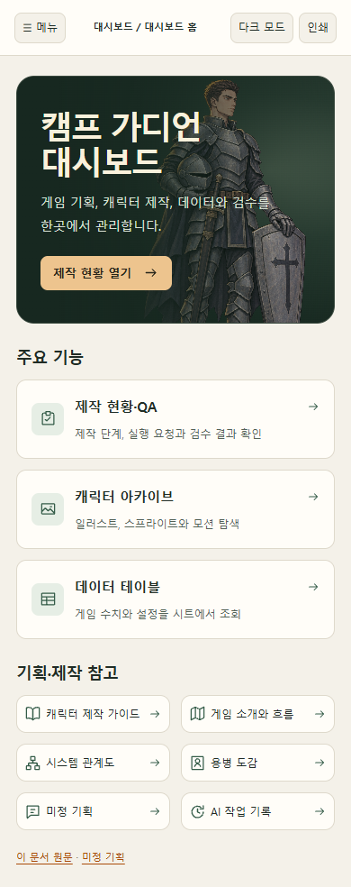
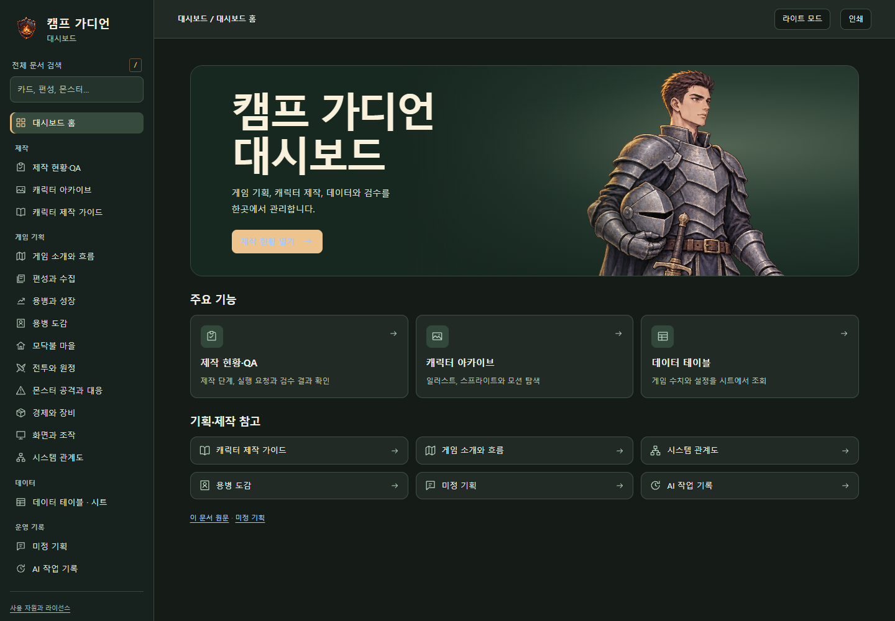
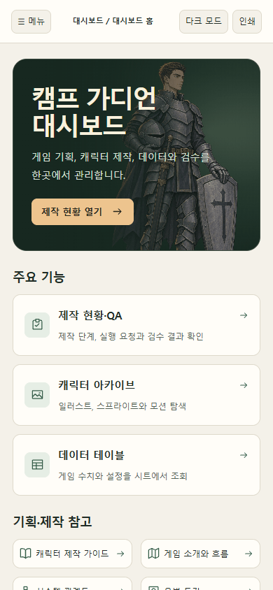

## 작업 결과

프로젝트 변경을 8f38869a로 커밋하고 main에 푸시했습니다.

## 변경 내용

### 적용 내용

제작, 게임 기획, 데이터, 운영 기록의 아이콘 메뉴와 반응형 홈 바로가기를 적용했습니다. 잿빛 기사 일러스트를 재사용했습니다.

## 검증

Chrome에서 17개 메뉴 노출, 주요 화면 6곳 이동, 검색, 다크 모드, 모바일 메뉴 열기와 닫기, 390px 화면의 가로 폭을 확인했습니다. 모바일 화면 전환은 3프레임 GIF로 확인했습니다.

## 남은 사항

공개 배포와 제작 요청 제출 미확인. 중앙 업데이트 보드는 원격 조회에 실패해 로컬 2026-11-21-011 기준을 적용했습니다.

## 작업 시간

- 제안 시간: 10분
- 실제로 완료된 시간: 약 6분, 16:31 KST 프로젝트 푸시 완료
- XERJ: 미사용 — Chrome 렌더링 및 브라우저 상태 확인
