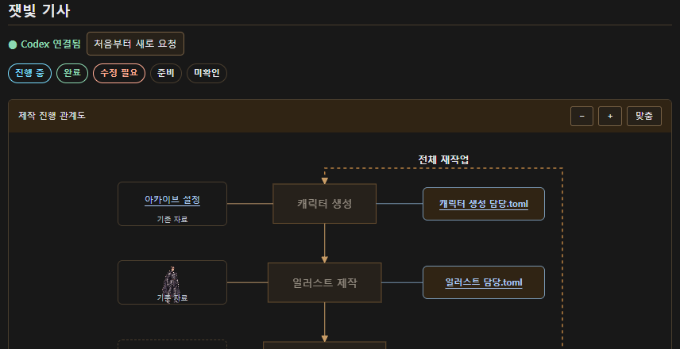

## 작업 결과

기본 43128 서버의 연결 API가 405를 반환하던 원인을 확인했습니다. 두 로컬 서버를 갱신해 실제 Codex 로그인 응답을 확인했습니다.

## 변경 내용

### 적용 내용

연결 상태 확인 중과 서버 미지원 오류를 구분해 표시합니다. 파일 페이지나 구버전 서버에서 로컬 대시보드 링크를 제공합니다. 같은 파일에 진행되던 홈 제작 현황 변경을 보존했습니다.

## 검증

Chrome에서 실제 43128·43129 주소의 연결, 구버전 405 응답 안내, 버튼 재시도 뒤 실제 연결 복구, 파일 페이지의 로컬 링크를 확인했습니다. 프로젝트 main 3dc435b3을 푸시했습니다.

## 남은 사항

공개 배포는 미확인입니다.

## 작업 시간

- 제안 시간: 3~5분
- 실제로 완료된 시간: 2026-11-21 17:13:45~17:15:59 KST, 약 2분 14초
- XERJ: 미사용 — 로컬 주소와 로그인 응답, Chrome 및 Git으로 확인했습니다.
