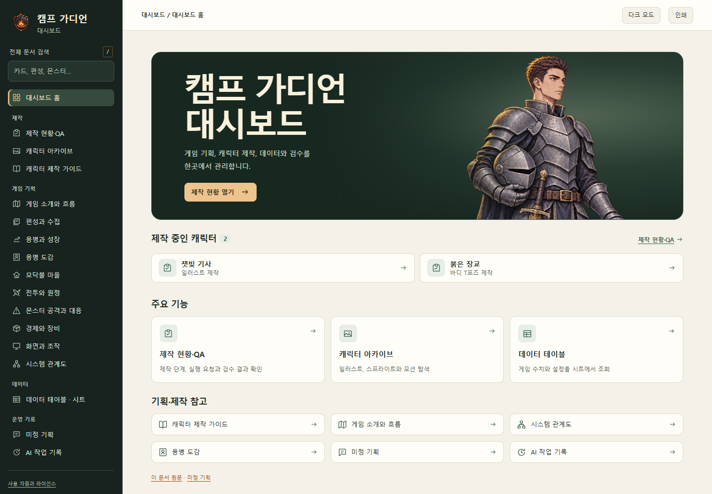
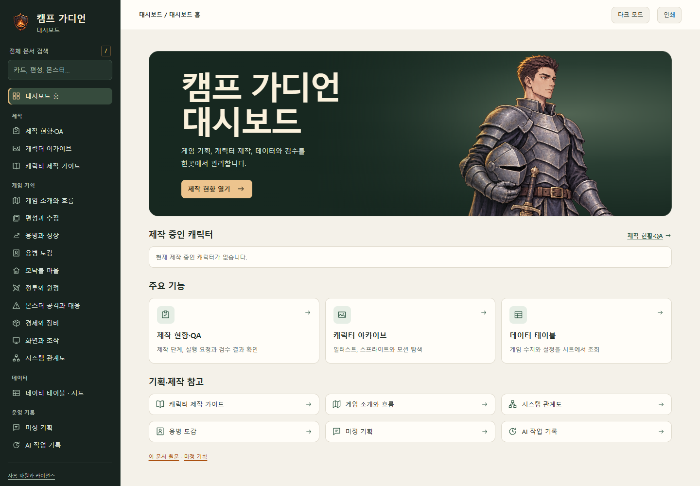
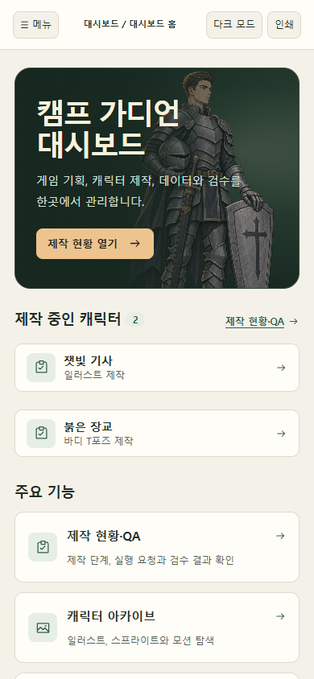

## 작업 결과

프로젝트 71a24e34을 main에 푸시했습니다. 현재 저장 기록에는 제작 중인 캐릭터가 없습니다.

## 변경 내용

### 적용 내용

홈 상단에 제작 중인 캐릭터를 표시하고, 기록에서 진행 중으로 등록된 단계만 읽습니다. HTTP 환경에서 기존 제작 현황의 자동 갱신 주기를 사용합니다.

## 검증

Chrome에서 실제 빈 상태, 검수용 캐릭터 2건과 단계 표시, 자동 갱신, 완료 건 제거, 390px 모바일 화면과 해당 캐릭터 상세 이동을 확인했습니다.

## 남은 사항

전체 문서 빌드와 공개 배포 미확인. 검수용 데이터는 브라우저 응답에만 적용했습니다.

## 작업 시간

- 제안 시간: 7분
- 실제로 완료된 시간: 약 4분 28초, 17:17:51 KST 프로젝트 반영
- XERJ: 미사용 — Chrome 실제 렌더와 경로 확인
