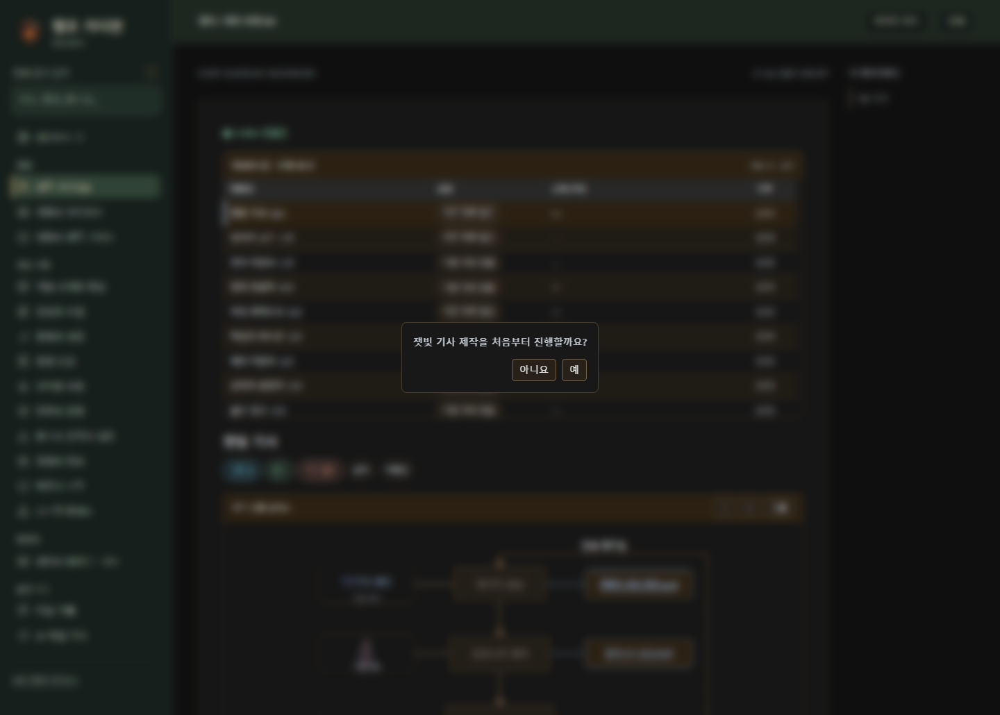

## 작업 결과

‘처음부터 진행할까요?’에서 예를 누르면 별도 터미널 창 없이 로컬 Codex 실행을 시작합니다. 진행 중 취소 시 실행을 중단하고 기존 파일을 보존합니다.

## 변경 내용

### 적용 내용

대기 요청도 상태 버튼으로 시작하거나 취소할 수 있습니다. 연결 표시는 목록 상단에 있습니다.

## 검증

Chrome과 격리한 검증용 CLI 프로세스에서 아니요 선택 시 요청 미접수, 예 선택 시 백그라운드 시작, 진행 중 취소 및 검수 상태 정리를 확인했습니다. 실제 서버의 Codex 로그인 확인을 마쳤습니다. main acac8508에 푸시했습니다.

## 남은 사항

실제 잿빛 기사 대기 요청은 실행하지 않았습니다. 실제 이미지 생성은 미확인입니다.

## 작업 시간

- 제안 시간: 8~10분
- 실제로 완료된 시간: 2026-11-21 17:18:38~17:23:09 KST, 약 4분 31초
- XERJ: 미사용 — Chrome, 격리된 검증 프로세스와 Git으로 확인했습니다.
