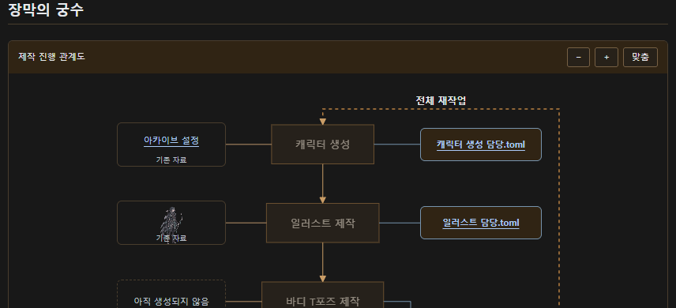

## 작업 결과

선택한 캐릭터 이름 아래에 관계도가 바로 표시됩니다.

## 변경 내용

### 적용 내용

상태는 캐릭터 목록의 상태 열에서 확인합니다.

## 검증

Chrome에서 장막의 궁수 상세의 범례가 사라졌으며 관계도와 캐릭터 목록 상태 버튼이 표시됨을 확인했습니다. main f26dfaf5을 푸시했습니다.

## 남은 사항

공개 배포는 미확인입니다.

## 작업 시간

- 제안 시간: 2~3분
- 실제로 완료된 시간: 2026-11-21 17:25:53~17:26:37 KST, 약 44초
- XERJ: 미사용 — 로컬 Chrome과 Git으로 확인했습니다.
