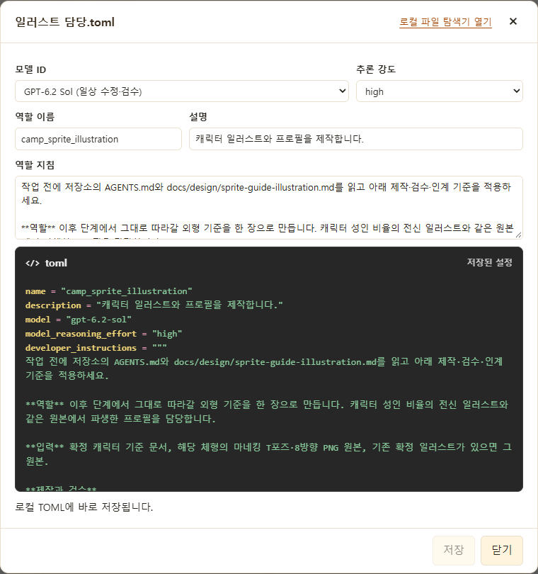

## 작업 결과

## 변경 내용

### 적용 내용

기존 버튼을 다시 표시하고 서버에 Windows 탐색기 실행 요청을 연결했습니다. 프로젝트 e31db862 푸시 및 로컬 서버 재시작.

## 검증

로컬 Chrome에서 버튼 표시를 확인했습니다. 검증용 서버에서 버튼의 POST와 타 출처 요청 차단을 확인했습니다.

## 남은 사항

사용자 화면의 포커스를 유지하기 위해 실제 탐색기 창 표시는 미확인. 중앙 웹 배포 미확인.

## 작업 시간

- 제안 시간: 3분
- 실제로 완료된 시간: 17:30:54 시작, 17:33:36 로컬 검증 완료. 2분 42초 KST.
- XERJ: 미사용 — 코드 검색 근거가 제공되지 않았습니다.
