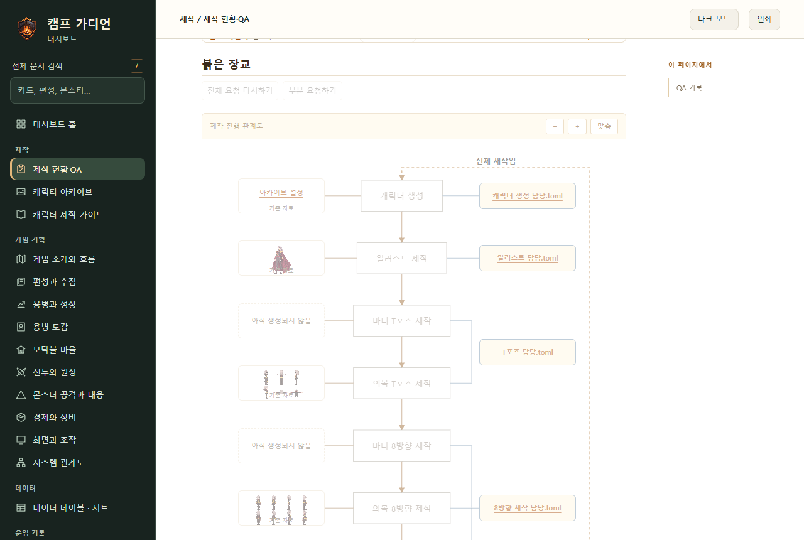

## 작업 결과

프로젝트 00e0fc83을 main에 푸시했습니다.

## 변경 내용

### 적용 내용

웹에서 페이지별 경로와 History API를 사용합니다. 기존 해시 주소를 새 경로로 전환합니다. 로컬 HTML 파일에는 쿼리 주소를 사용합니다.

## 검증

Chrome에서 제작 상세 직접 열기, 앱 로딩 지연 중 홈 숨김, 새로고침, 뒤로·앞으로 및 뒤로 갈 때 스크롤 위치, 아카이브와 데이터 시트 주소, 기존 해시 주소 및 로컬 파일을 확인했습니다. 정적 호스팅은 저장소 경로 접두사를 사용하는 로컬 정적 서버 설정에서 확인했습니다.

## 남은 사항

전체 문서 빌드와 공개 사이트 배포 미확인. 지침 원격 조회 실패로 로컬 2026-11-21-011 적용.

## 작업 시간

- 제안 시간: 10분
- 실제로 완료된 시간: 7분 7초, 17:36:08 KST 프로젝트 푸시 완료
- XERJ: 미사용 — 로컬 대시보드 서버와 Chrome 실제 렌더
