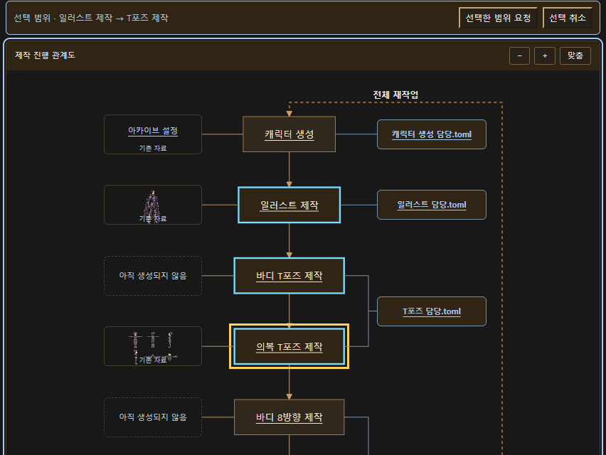

## 작업 결과

전체 요청은 확인창에서 확정합니다. 부분 요청에서 관계도가 포커스되고 시작·종료 단계를 고릅니다. 같은 단계를 두 번 고르면 해당 단계만 선택합니다.

## 변경 내용

### 적용 내용

선택 범위를 강조하고 확정하면 그 단계만 백그라운드 제작 요청에 넣습니다. 새 작업의 결과는 별도 경로를 쓰도록 요청합니다.

## 검증

Chrome에서 전체 요청 확인과 취소, 관계도 포커스, 동일 단계 선택, 세 단계 범위와 도형 강조, 격리된 백그라운드 요청의 실제 입력 단계 및 취소를 확인했습니다. 로컬 서버를 갱신하고 main에 cb3d1a3f를 푸시했습니다.

## 남은 사항

실제 캐릭터 제작은 실행하지 않았습니다. 공개 보고서 배포는 미확인입니다.

## 작업 시간

- 제안 시간: 6~8분
- 실제로 완료된 시간: 2026-11-21 17:32:19~17:36:23 KST, 약 4분 4초
- XERJ: 미사용 — 로컬 Chrome, 검증용 백그라운드 프로세스와 Git으로 확인했습니다.
