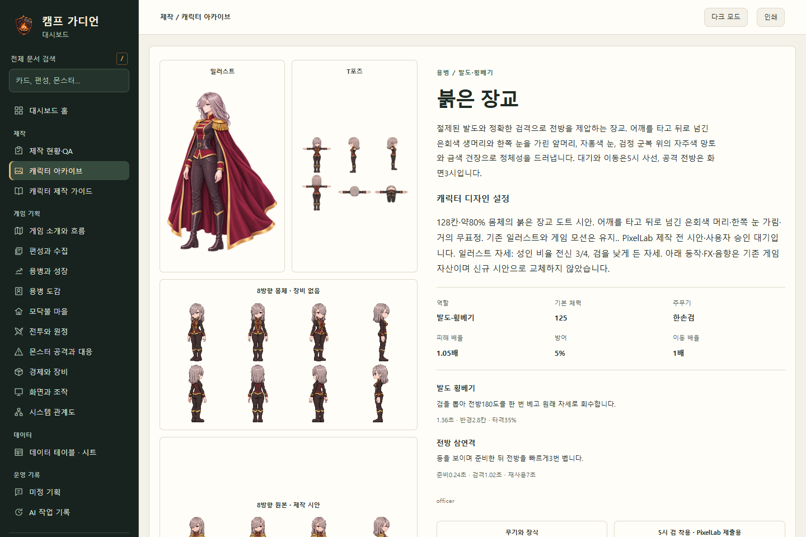
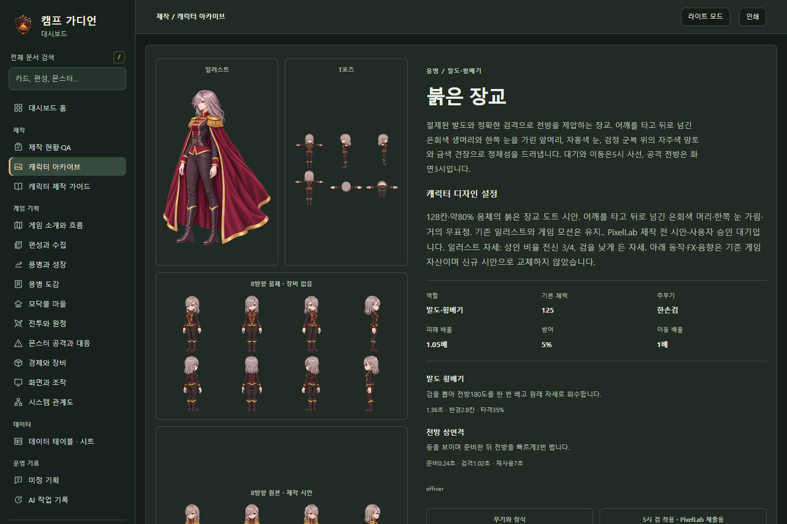
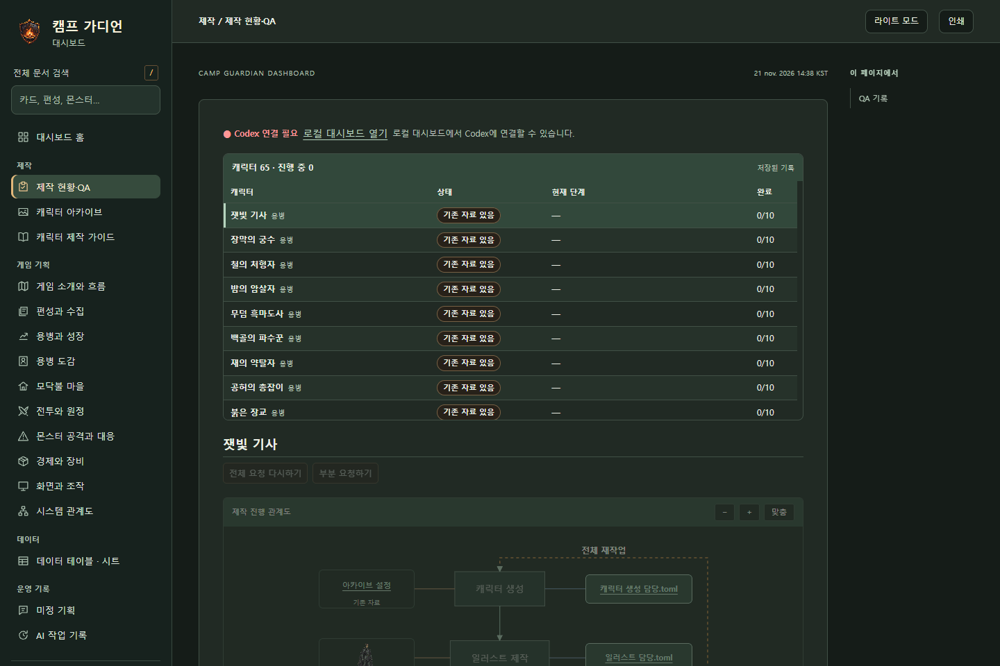
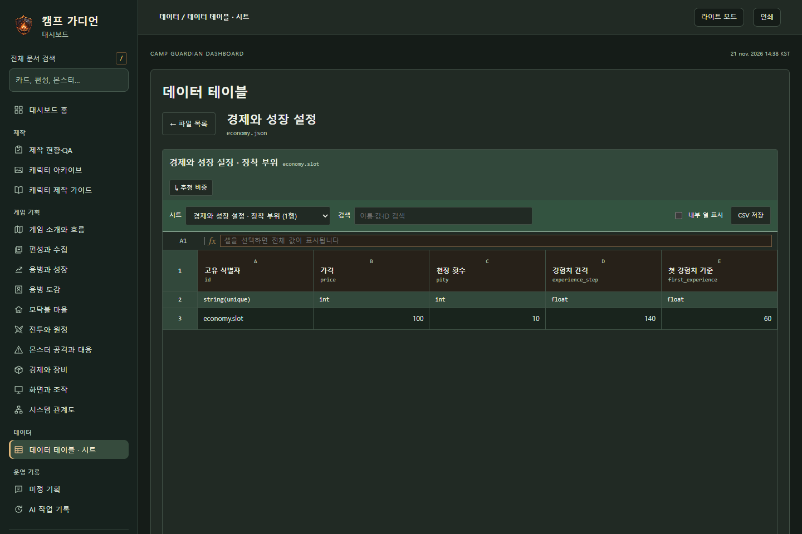

## 작업 결과

프로젝트 9d834027을 main에 푸시했습니다.

## 변경 내용

### 적용 내용

크림·녹색 라이트와 짙은 녹색 다크를 본문, 제작 현황 표, 관계도, 데이터 시트, 모달에 적용했습니다. 상태색과 캐릭터 목록을 유지했습니다.

## 검증

Chrome에서 아카이브 상단 제거와 이미지 확대, 제작 현황 표·관계도 및 데이터 시트의 두 모드, 게임 기획 본문과 AI 작업 기록 색상을 확인했습니다.

## 남은 사항

전체 문서 빌드와 공개 사이트 배포 미확인. 지침 원격 조회 실패로 로컬 2026-11-21-011 적용.

## 작업 시간

- 제안 시간: 10분
- 실제로 완료된 시간: 5분 5초, 17:43:34 KST 프로젝트 푸시 완료
- XERJ: 미사용 — 로컬 대시보드 서버와 Chrome 실제 렌더
