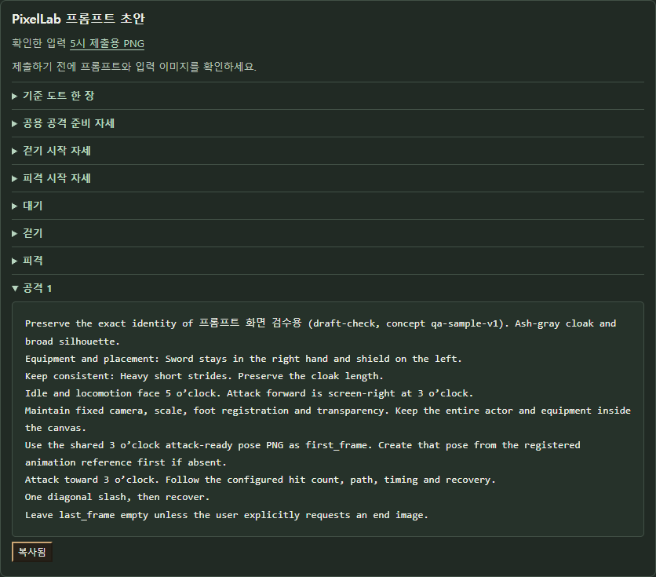

## 작업 결과

캐릭터별 외형, 장비 손, 동작 특징을 별도의 콘셉트 파일로 인계합니다. 최종 QA 통과 시 제작 현황·QA에서 초안을 펼치고 복사할 수 있습니다.

## 변경 내용

### 적용 내용

5시 제출 PNG의 경로와 SHA-256을 기록하고, 선택한 모션과 필요한 시작 자세만 생성합니다. 제출은 별도 사용자 지시 후 진행합니다.

## 검증

실제 프로젝트 PNG를 사용한 격리 기록과 Chrome에서 QA 통과 전 숨김, 통과 후 초안 생성, 입력 해시, 캐릭터별 동작, 복사, 제작 재개 시 초안 무효화를 확인했습니다. PixelLab 호출이나 차감은 없었습니다. main dd8a38b7을 푸시했습니다.

## 남은 사항

실제 캐릭터 제출과 생성 결과는 미확인입니다. 공개 보고서 배포는 미확인입니다.

## 작업 시간

- 제안 시간: 6~8분
- 실제로 완료된 시간: 2026-11-21 17:40:23~17:45:12 KST, 약 4분 49초
- XERJ: 미사용 — 격리 기록 CLI, Chrome 및 Git으로 확인했습니다.
