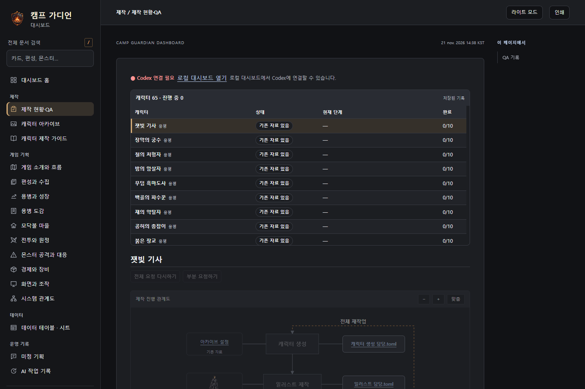
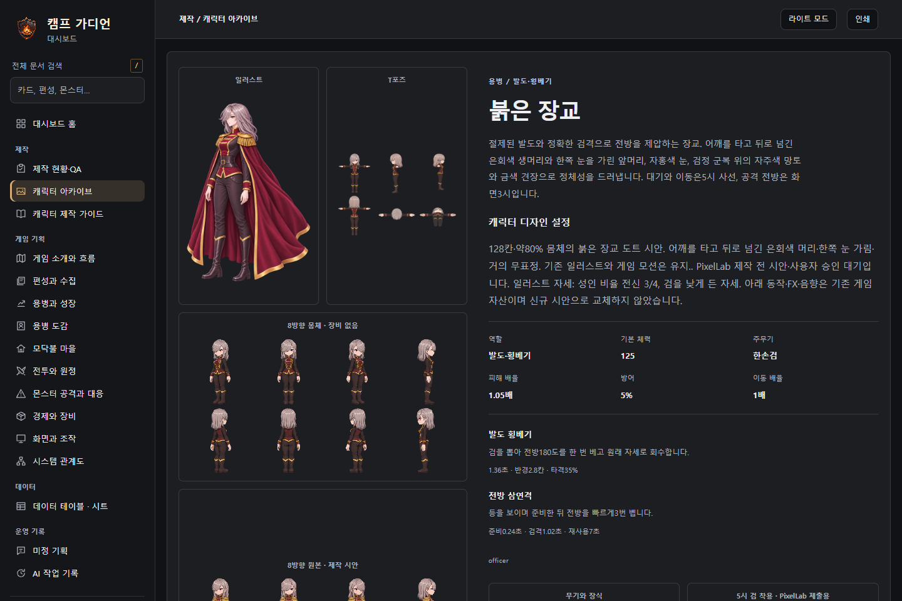
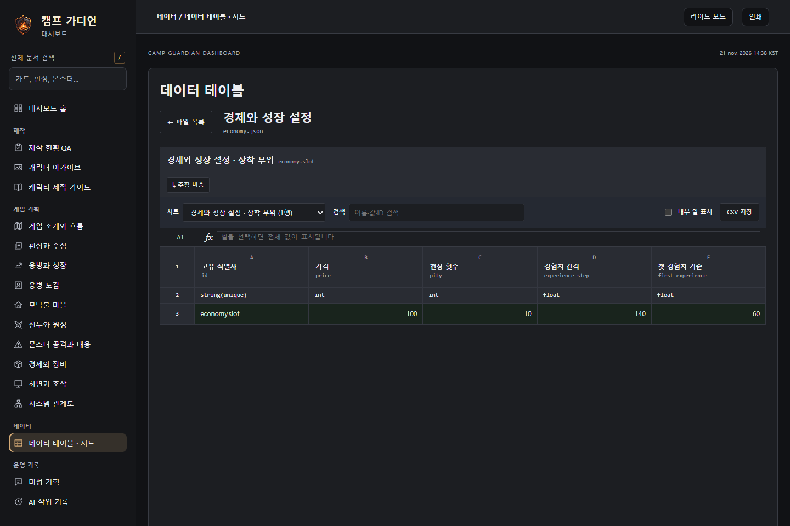

## 작업 결과

프로젝트 86d5524f을 main에 푸시했습니다.

## 변경 내용

### 적용 내용

다크 배경·패널·사이드바·표·데이터 시트·이미지 확대의 색을 보정했습니다. 라이트 모드와 상태색을 보존했습니다.

## 검증

Chrome에서 제작 현황의 일반 행과 선택 행, 캐릭터 아카이브, 게임 기획 본문, 시트, AI 기록과 이미지 확대를 확인했습니다. 두 모드의 계산된 색상과 실제 화면을 대조했습니다.

## 남은 사항

전체 문서 빌드와 공개 사이트 배포 미확인. 지침 원격 조회 실패로 로컬 2026-11-21-011 적용.

## 작업 시간

- 제안 시간: 7분
- 실제로 완료된 시간: 1분 54초, 17:51:14 KST 프로젝트 푸시 완료
- XERJ: 미사용 — 로컬 대시보드 서버와 Chrome 실제 렌더
