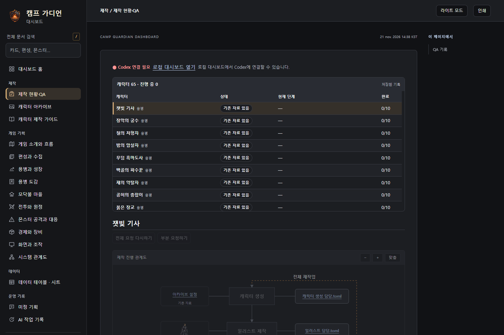

## 작업 결과

프로젝트 c36f1a41을 main에 푸시했습니다.

## 변경 내용

### 적용 내용

라이트 화면의 크림색과 녹색을 밝은 회색·슬레이트로 조정하고 두 모드에 황동색 선택 표시를 적용했습니다.

## 검증

Chrome에서 라이트 홈 제목 대비, 양쪽 모드의 표·시트·캐릭터 아카이브·확대 모달 배경과 선택 행을 확인했습니다.

## 남은 사항

전체 문서 빌드와 공개 사이트 배포 미확인. 지침 원격 조회 실패로 로컬 2026-11-21-011 적용.

## 작업 시간

- 제안 시간: 5분
- 실제로 완료된 시간: 1분 32초, 17:59:25 KST 프로젝트 푸시 완료
- XERJ: 미사용 — 로컬 대시보드 서버와 Chrome 실제 렌더
