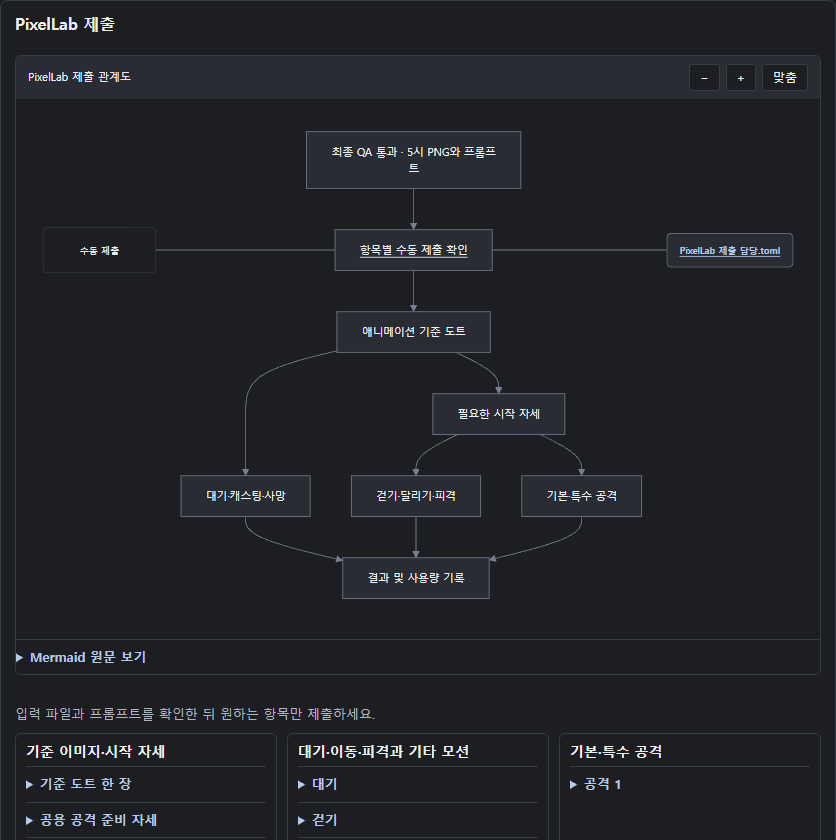
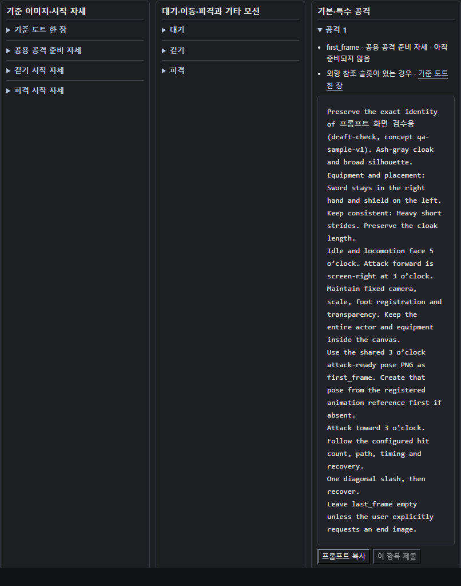

## 작업 결과

본 제작은 최종 QA에서 끝납니다. PixelLab은 항목과 검증된 파일을 확인하고 사용자가 별도로 승인한 한 건만 접수합니다. 필요한 기준 도트·시작 자세가 없으면 해당 모션은 잠깁니다.

## 변경 내용

### 적용 내용

PixelLab 전용 TOML과 제작 지침을 추가했습니다. 기존 부분 제작 범위는 시작과 종료를 순서대로 보여주고, 시작 이전 단계와 선택 완료 후 단계는 비활성화합니다.

## 검증

Chrome과 격리된 요청 기록에서 QA 전 잠금, 확인 없이 접수 거부, 승인 한 건, 입력 해시, 결과 등록 뒤 의존 모션 활성화, 기존 부분 요청 단계 선택을 확인했습니다. 로컬 TOML 경로가 정상이며 main e7b88277을 푸시했습니다.

## 남은 사항

실제 PixelLab 호출과 차감은 없었습니다. 현재 로컬 Codex에서 실제 제출에 쓸 PixelLab 연결은 확인되지 않았습니다. 공개 보고서 배포는 미확인입니다.

## 작업 시간

- 제안 시간: 10~15분
- 실제로 완료된 시간: 2026-11-21 17:53:26~18:00:53 KST, 약 7분 27초
- XERJ: 미사용 — 로컬 Chrome, 격리된 요청 처리, TOML 검증과 Git으로 확인했습니다.
