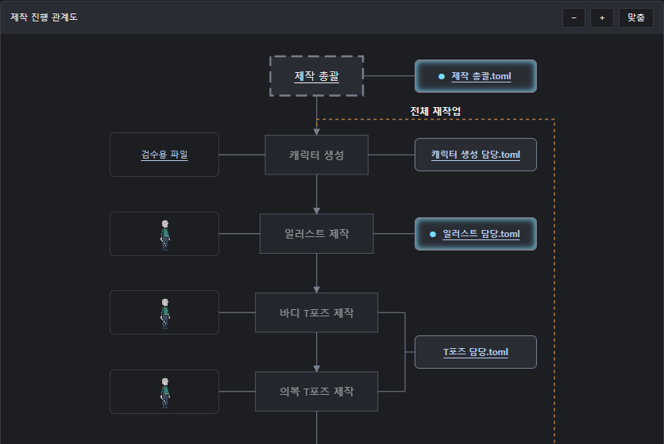
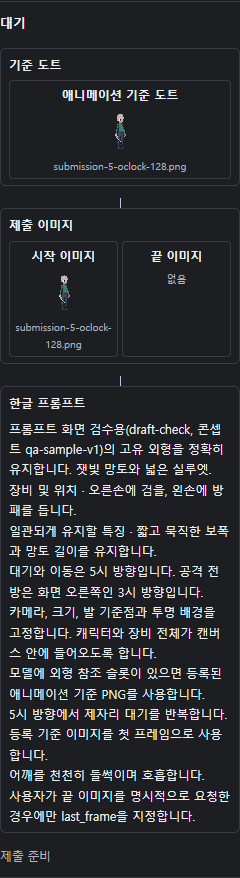
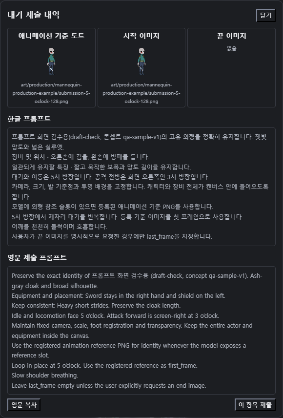

## 작업 결과

총괄은 배정, 인계 확인, QA 반려 범위 재배정을 담당합니다. 제작 실무와 최종 QA 판정은 단계별 담당자가 맡습니다. PixelLab은 사용자 별도 승인 한 건만 유지합니다.

## 변경 내용

### 적용 내용

준비된 이미지는 썸네일로 보여주고 입력이 없으면 없음을 표시합니다. 카드에는 한글을 표시하며, 팝업에 이미지와 한글·영문 프롬프트를 함께 보여줍니다.

## 검증

격리된 요청 기록에서 중복 총괄 거부, 부분 범위 제한, 최초 QA와 재검수 최대 5회 및 취소 처리를 확인했습니다. Chrome에서 총괄·단계 담당 활성 표시와 종료 시 해제, 3단, 이미지·양 언어 팝업과 팝업 조회 시 PixelLab 요청이 접수되지 않음을 확인했습니다. main 9eb29275을 푸시하고 로컬 서버를 갱신했습니다.

## 남은 사항

실제 캐릭터 제작에서 모델의 총괄 호출 및 담당자 인계는 미확인입니다. 실제 PixelLab 제출과 차감은 없었습니다. 기존 자료에 한글 짝이 없으면 미등록으로 표시합니다.

## 작업 시간

- 제안 시간: 12~18분
- 실제로 완료된 시간: 2026-11-21 18:07:58~18:13:51 KST, 약 5분 53초
- XERJ: 미사용 — 로컬 Chrome, 격리 요청 기록, TOML 및 Git으로 확인했습니다.
