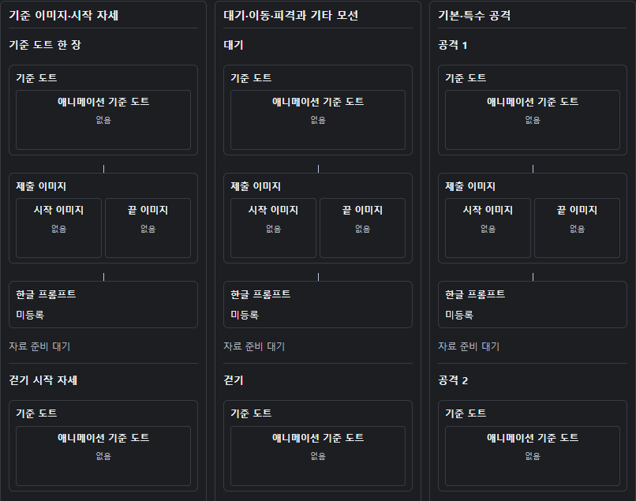

## 작업 결과

비어 있는 이미지는 없음, 미작성 프롬프트는 미등록으로 표시합니다. 자료를 등록하면 같은 칸에서 확인할 수 있습니다.

## 변경 내용

### 적용 내용

준비되지 않은 카드에서 영문 복사와 제출을 비활성화합니다.

## 검증

Chrome에서 카드 15개와 3층 45개, 없음과 미등록 문구, 팝업 제출 잠금을 확인했습니다. main 17ea103b를 푸시했습니다.

## 남은 사항

실제 PixelLab 호출과 차감은 없었습니다. 공개 보고서 배포는 미확인입니다.

## 작업 시간

- 제안 시간: 3~5분
- 실제로 완료된 시간: 2026-11-21 18:16:32~18:17:47 KST, 약 1분 15초
- XERJ: 미사용 — 로컬 Chrome 및 Git으로 확인했습니다.
