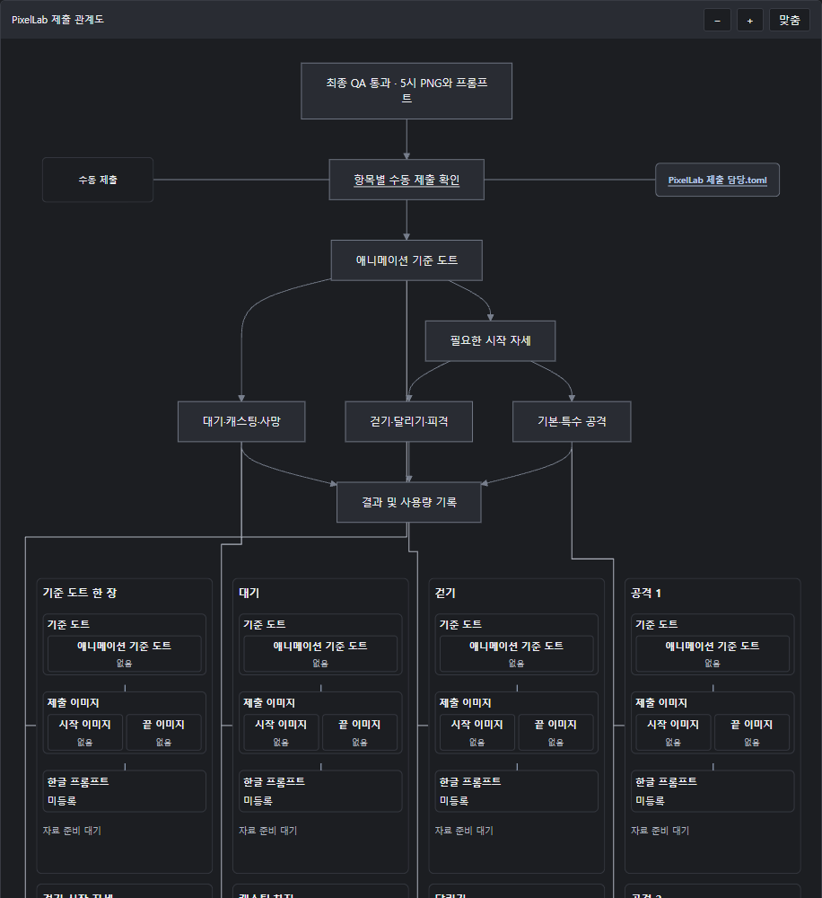

## 작업 결과

4개 분기에 15개 준비·모션 도형과 45개 클릭 가능한 층이 표시됩니다. 선택한 층에서 제출 상세를 확인합니다.

## 변경 내용

### 적용 내용

기준 도트, 입력 이미지, 한글 프롬프트는 같은 모션 도형 안에 표시합니다. QA 전에도 도형은 보이고 제출은 잠깁니다.

## 검증

Chrome에서 같은 SVG의 15개 도형과 45개 층, 4개 분기, 19개 연결선, 빈 카드 잘림 여부, 공격 1 팝업과 제출 잠금을 확인했습니다. 프로젝트 main 2e49cf2d에 푸시했습니다.

## 남은 사항

PixelLab 제출과 차감은 없었습니다. 공개 배포는 미확인입니다.

## 작업 시간

- 제안 시간: 6~8분
- 실제로 완료된 시간: 2026-11-21 18:19:54~18:22:43 KST, 약 2분 49초
- XERJ: 미사용 — 로컬 Chrome과 Git으로 확인했습니다.
