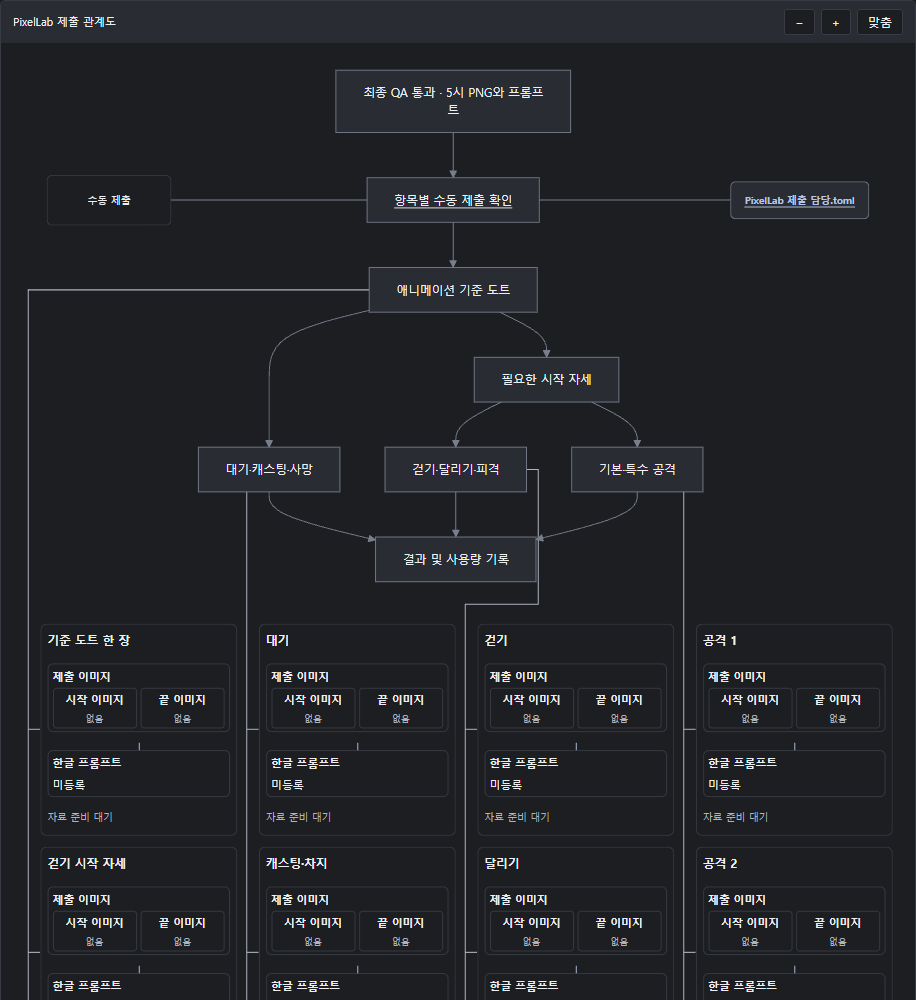
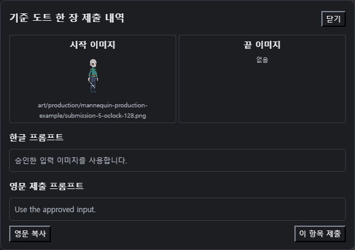

## 작업 결과

정지 이미지 입력은 시작 칸에 매핑됩니다. 끝 이미지가 비어 있으면 없음이 표시됩니다. 모션별 연결선은 분기 옆에서 바깥쪽으로 뻗습니다.

## 변경 내용

### 적용 내용

두 칸으로 줄어든 카드 높이를 조정했습니다.

## 검증

Chrome에서 관계도 내 15개 도형과 30개 층, 4개 분기, 상세 팝업의 시작·끝 두 칸, 실제 PNG가 시작에 표시되고 끝이 없음으로 표시되는 검증용 사례를 확인했습니다. main 4710e247을 푸시했습니다.

## 남은 사항

실제 PixelLab 제출과 차감은 없었습니다. 공개 배포는 미확인입니다.

## 작업 시간

- 제안 시간: 5~7분
- 실제로 완료된 시간: 2026-11-21 18:25:15~18:26:43 KST, 약 1분 28초
- XERJ: 미사용 — 로컬 Chrome과 Git으로 확인했습니다.
