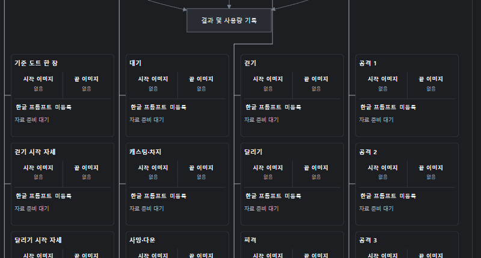

## 작업 결과

프로젝트 main에 1284154f를 푸시했습니다.

## 변경 내용

### 적용 내용

- 모션 카드의 테두리를 한 겹으로 줄였습니다.
- PixelLab 상세 팝업 바깥을 클릭하면 닫힙니다.

## 검증

로컬 Chrome에서 시작·끝 이미지와 한글 프롬프트 배치, 상세 팝업 내부 클릭 시 유지, 바깥 클릭 및 Escape로 닫기를 확인했습니다.

## 남은 사항

공개 페이지 배포 및 미디어 접근 미확인.

## 작업 시간

- 제안 시간: 4~6분
- 실제로 완료된 시간: 2026-11-21 18:34:14~18:36:24 KST, 2분 10초
- XERJ: 미사용 — 로컬 Chrome과 Git으로 확인했습니다.
