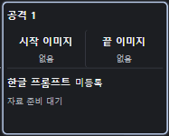

## 작업 결과

프로젝트 main에 c3d256f0을 푸시했습니다.

## 변경 내용

### 적용 내용

- 마우스를 올리거나 키보드로 포커스하면 카드 외곽에 테두리를 표시합니다.

## 검증

로컬 Chrome에서 카드당 상세 버튼 한 개, 카드 테두리 포커스, Enter 및 카드 안 클릭으로 팝업 열기, 바깥을 눌러 닫기를 확인했습니다.

## 남은 사항

공개 페이지 배포는 별도 확인입니다.

## 작업 시간

- 제안 시간: 3~5분
- 실제로 완료된 시간: 2026-11-21 18:42:37~18:44:13 KST, 약 1분 36초
- XERJ: 미사용 — 로컬 Chrome과 Git으로 확인했습니다.
