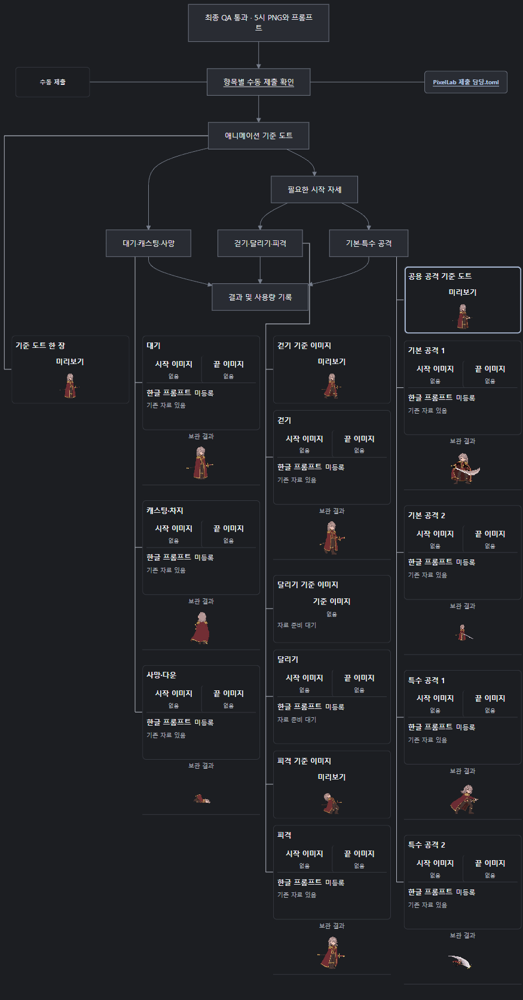

## 작업 결과

프로젝트 main에 2a463be5를 푸시했습니다.

## 변경 내용

### 적용 내용

- 기본 공격 1·2, 특수 공격 1·2 슬롯과 초안 사양을 적용했습니다.
- 식별 가능한 붉은 장교와 잿빛 기사 결과를 기존 자료로 연결했습니다.

## 검증

로컬 Chrome에서 붉은 장교 미리보기 13개 로드, 공격 슬롯 이름, 달리기 빈 칸, 공용 공격 기준 도트 상세 팝업을 확인했습니다.

## 남은 사항

달리기 전용 기준 이미지와 결과는 미등록입니다. 공개 페이지 반영은 별도 확인입니다.

## 작업 시간

- 제안 시간: 8~10분
- 실제로 완료된 시간: 2026-11-21 18:46:08~18:51:24 KST, 약 5분 16초
- XERJ: 미사용 — 로컬 Chrome과 Git으로 확인했습니다.
