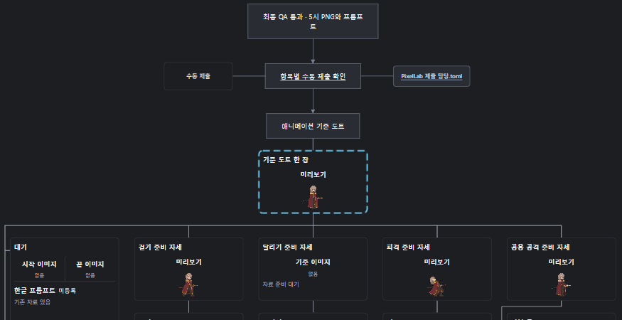
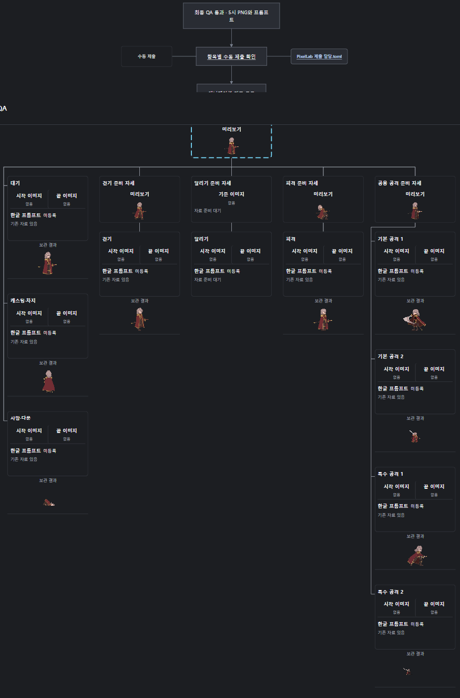

## 작업 결과

프로젝트 main에 a6e8464e를 푸시했습니다.

## 변경 내용

### 적용 내용

- 대기·캐스팅·사망은 공용 기준 도트에서, 걷기·달리기·피격은 각 준비 자세에서 이어집니다.
- 공용 공격 준비 자세는 기본·특수 공격 4개에 연결했습니다.
- 아래 GIF는 실제 대시보드에 모의 진행 상태를 표시해 캡처했습니다.

## 검증

로컬 Chrome에서 미리보기 13개, 기준 도트 수직 배치, 개별 준비 자세 3개, 공격 상세 팝업, 모의 진행 상태의 테두리 애니메이션을 확인했습니다.

## 남은 사항

공개 페이지 반영은 별도 확인입니다.

## 작업 시간

- 제안 시간: 5~8분
- 실제로 완료된 시간: 2026-11-21 18:54:32~18:57:28 KST, 약 2분 56초
- XERJ: 미사용 — 로컬 Chrome과 Git으로 확인했습니다.
