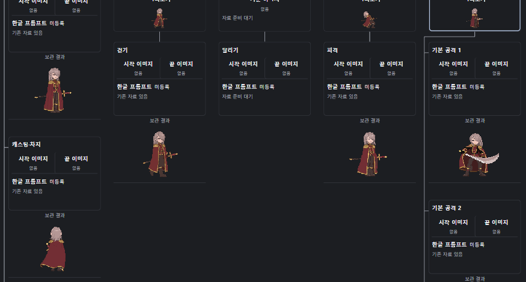

## 작업 결과

프로젝트 main에 e82d05da를 푸시했습니다.

## 변경 내용

### 적용 내용

- 결과 이미지와 배치 공간을 함께 확대했습니다.

## 검증

로컬 Chrome에서 붉은 장교 결과 이미지가 로드되고 높이가 132px이며 다음 카드와 겹치지 않는 것을 확인했습니다.

## 남은 사항

공개 페이지 배포는 별도 확인입니다.

## 작업 시간

- 제안 시간: 3~5분
- 실제로 완료된 시간: 2026-11-21 19:02:02~19:02:45 KST, 약 43초
- XERJ: 미사용 — 로컬 Chrome과 Git으로 확인했습니다.
