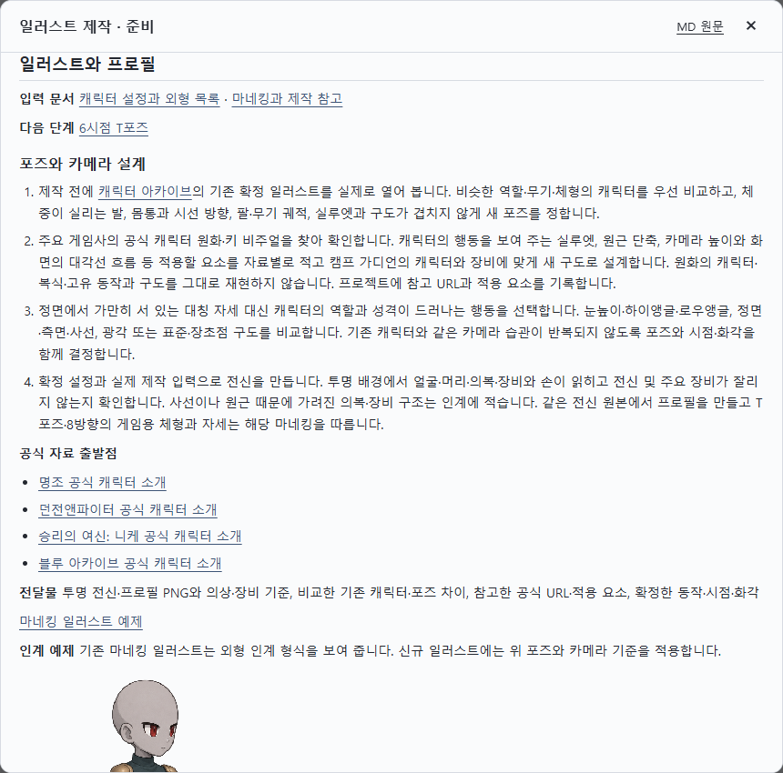

## 작업 결과

프로젝트 main에 cc8445d9를 푸시했습니다.

## 변경 내용

### 적용 내용

- 부분 요청 중에는 도형에서 범위를 선택합니다.

## 검증

로컬 Chrome에서 지침 팝업 네 개와 일러스트 단일 단계 부분 범위 선택을 확인했습니다.

## 남은 사항

공개 페이지 배포는 별도 확인입니다.

## 작업 시간

- 제안 시간: 2~4분
- 실제로 완료된 시간: 2026-11-21 19:03:22~19:05:15 KST, 약 1분 53초
- XERJ: 미사용 — 로컬 Chrome과 Git으로 확인했습니다.
