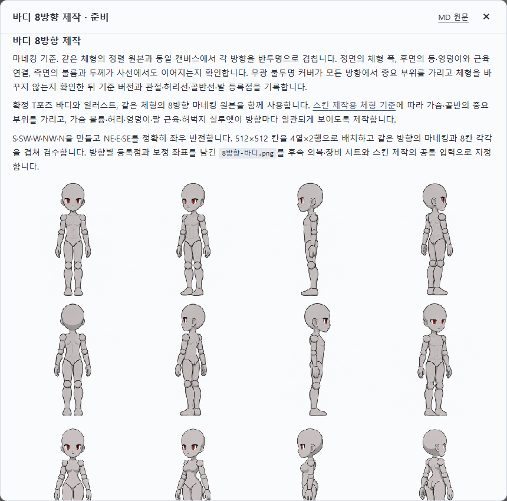

## 작업 결과

프로젝트 main에 aba90af9를 푸시했습니다.

## 변경 내용

### 적용 내용

- 바디·의복 T포즈와 바디·의복·장비 8방향의 단계별 기준을 추가했습니다.

## 검증

로컬 Chrome에서 제작 관계도의 T포즈와 8방향 지침 팝업에 다섯 기준 문단이 표시되는 것을 확인했습니다.

## 남은 사항

공개 페이지 배포 및 접근 미확인.

## 작업 시간

- 제안 시간: 별도 제안 없음
- 실제로 완료된 시간: 2026-11-21 19:12:01~19:12:59 KST, 약 58초
- XERJ: 미사용 — 로컬 Chrome과 Git으로 확인했습니다.
