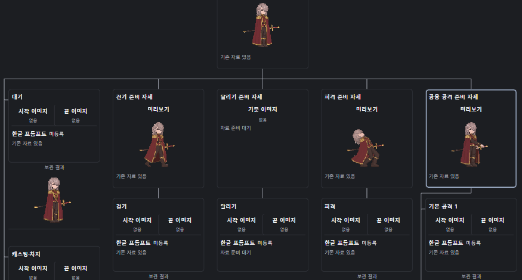

## 작업 결과

프로젝트 main에 c05cc2b2를 푸시했습니다.

## 변경 내용

### 적용 내용

- 제작 현황의 관계도와 지침 팝업에서 기존 가이드 자료를 사용합니다.

## 검증

로컬 Chrome에서 메뉴 및 홈 링크 제거, 두 관계도, 준비 자세 높이와 스크롤 유무, 기존 미리보기 13개를 확인했습니다.

## 남은 사항

공개 페이지 반영 미확인.

## 작업 시간

- 제안 시간: 3~5분
- 실제로 완료된 시간: 2026-11-21 19:34:56~19:37:33 KST, 약 2분 37초
- XERJ: 미사용 — 로컬 Chrome과 Git으로 확인했습니다.
