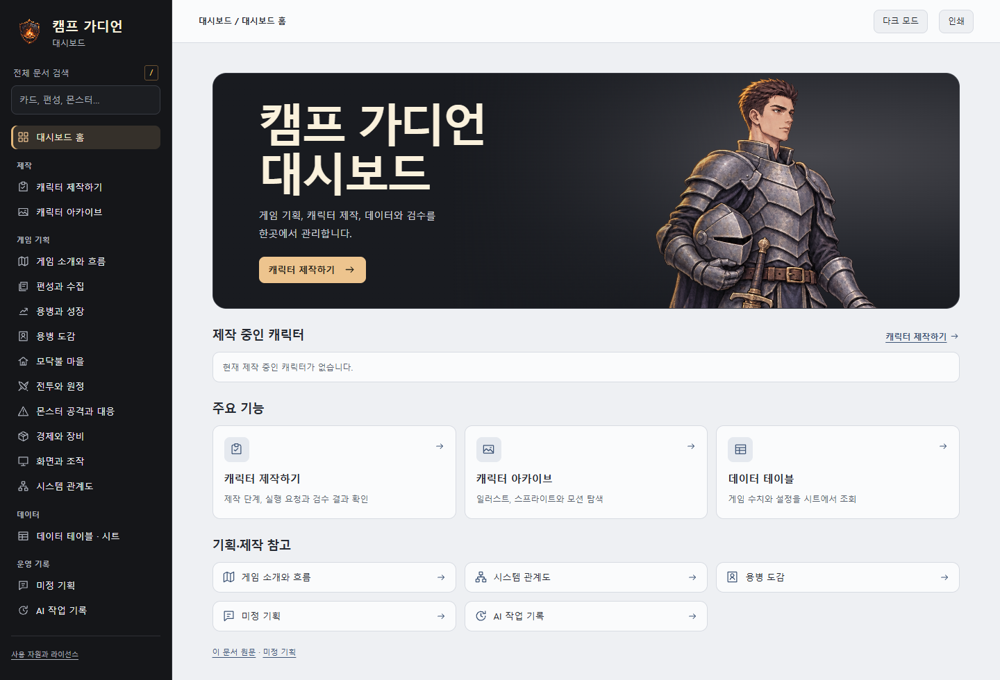
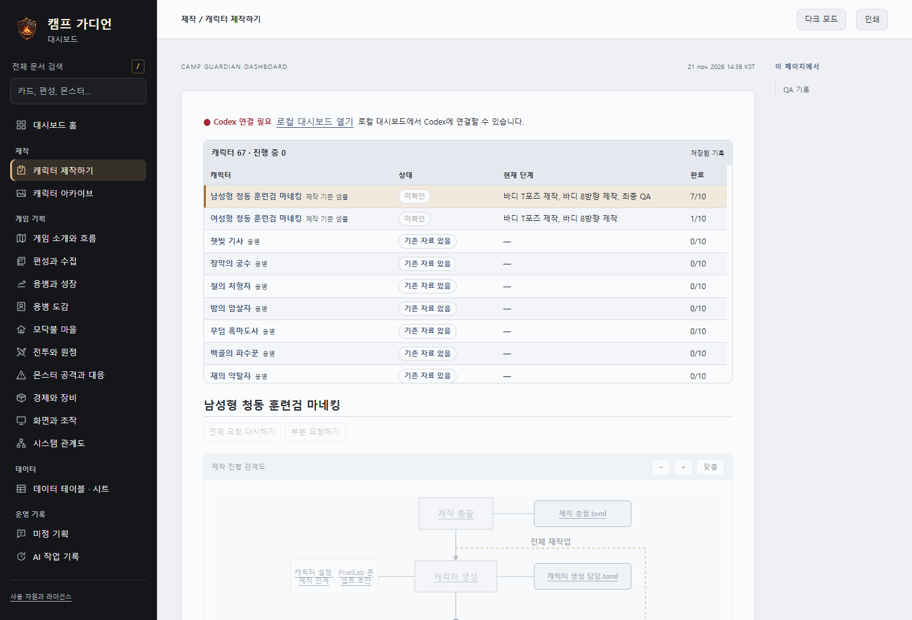

## 작업 결과

프로젝트 3dc3ee27을 main에 푸시했습니다.

## 변경 내용

### 적용 내용

사이드바, 홈 바로가기, 현재 위치, 브라우저 제목, 관련 안내 링크의 표기를 맞췄습니다. 기존 주소를 유지했습니다.

## 검증

Chrome에서 홈 바로가기 세 곳, 메뉴와 현재 위치, 문서 제목 및 기존 경로 이동을 확인했습니다.

## 남은 사항

전체 문서 빌드와 공개 사이트 배포 미확인. 지침 원격 조회 실패로 로컬 2026-11-21-011 적용.

## 작업 시간

- 제안 시간: 4분
- 실제로 완료된 시간: 1분 14초, 20:01:55 KST 프로젝트 푸시 완료
- XERJ: 미사용 — 로컬 대시보드 서버와 Chrome 실제 렌더
