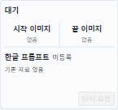

## 작업 결과

프로젝트 main에 094dfd40을 푸시했습니다.

## 변경 내용

### 적용 내용

## 검증

Chrome에서 기준 도트, 대기, 공격, 달리기의 모서리 위치와 모의 요청 동작을 확인했습니다.

## 남은 사항

공개 페이지 반영 미확인.

## 작업 시간

- 제안 시간: 별도 제안 없음
- 실제로 완료된 시간: 2026-11-21 20:27:35~20:28:14 KST, 39초
- XERJ: 미사용 — 로컬 Chrome과 Git으로 확인했습니다.
