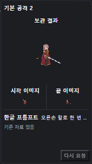

## 작업 결과

프로젝트 main에 57806901을 푸시했습니다.

## 변경 내용

### 적용 내용

- 붉은 장교와 잿빛 기사의 보관 기록에서 확인한 입력과 프롬프트를 연결했습니다.

## 검증

Chrome에서 붉은 장교의 기존 미리보기 13개, 기본 공격 2의 시작·끝 이미지, 한글 표시와 영문 팝업을 확인했습니다.

## 남은 사항

제작 기록에서 찾지 못한 입력은 빈 칸입니다. 공개 페이지 반영 미확인.

## 작업 시간

- 제안 시간: 6~10분
- 실제로 완료된 시간: 2026-11-21 20:33:27~20:37:37 KST, 4분 10초
- XERJ: 미사용 — 로컬 Chrome과 Git으로 확인했습니다.
