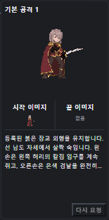

## 작업 결과

프로젝트 main에 37ebd70f와 eae9300e를 푸시했습니다.

## 변경 내용

### 적용 내용

## 검증

Chrome에서 크기 일치, 프롬프트 최대 네 줄, 보관 결과 문구 제거와 기존 미리보기를 확인했습니다.

## 남은 사항

공개 페이지 반영 미확인.

## 작업 시간

- 제안 시간: 3~5분
- 실제로 완료된 시간: 2026-11-21 20:41:54~20:44:02 KST, 2분 8초
- XERJ: 미사용 — 로컬 Chrome과 Git으로 확인했습니다.
