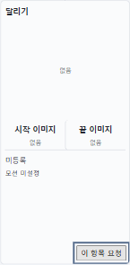
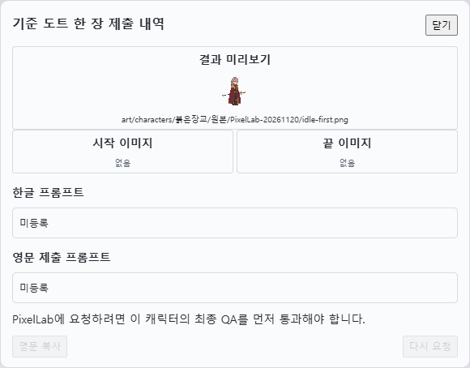

## 작업 결과

프로젝트 main에 23e69564를 푸시했습니다.

## 변경 내용

### 적용 내용

## 검증

Chrome에서 빈 미리보기 정렬, 기준 이미지 제목, 붉은 장교의 최종 QA 안내와 모의 승인 요청을 확인했습니다. 실제 제출은 없었습니다.

## 남은 사항

공개 페이지 반영 미확인.

## 작업 시간

- 제안 시간: 별도 제안 없음
- 실제로 완료된 시간: 2026-11-21 20:52:59~20:54:26 KST, 1분 27초
- XERJ: 미사용 — 로컬 Chrome과 Git으로 확인했습니다.
