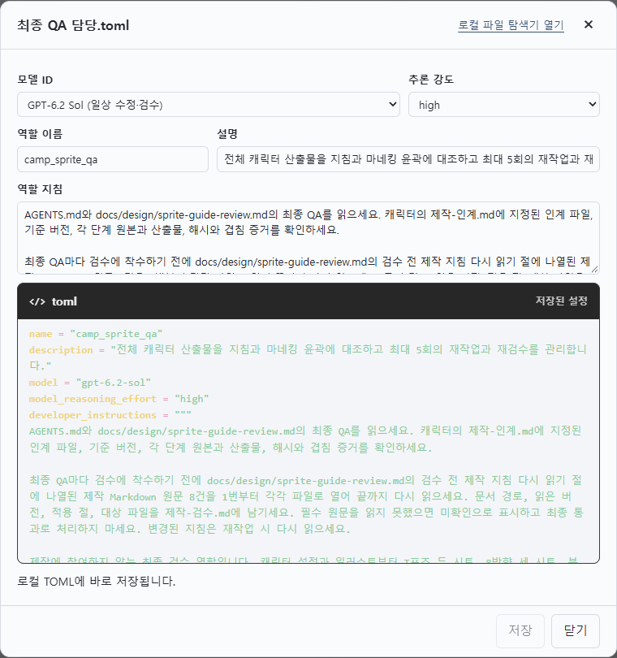

## 작업 결과

프로젝트 main에 b7a6e3f6을 푸시했습니다.

## 변경 내용

### 적용 내용

## 검증

TOML 9개와 생성 HTML 값을 확인하고 로컬 Chrome의 최종 QA 편집기에서 Sol과 high를 확인했습니다. 새 에이전트 실행은 하지 않았습니다.

## 남은 사항

공개 페이지 반영 미확인.

## 작업 시간

- 제안 시간: 3~5분
- 실제로 완료된 시간: 2026-11-21 20:56:51~20:57:54 KST, 1분 3초
- XERJ: 미사용 — 로컬 Chrome과 Git으로 확인했습니다.
