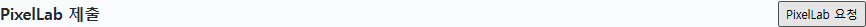

## 작업 결과

프로젝트 main에 7dd2057a를 푸시했습니다.

## 변경 내용

### 적용 내용

## 검증

Chrome에서 제작 전체 요청 확인창과 PixelLab 선택·항목별 승인 흐름을 확인했습니다. 실제 제출은 없었습니다.

## 남은 사항

공개 페이지 반영 미확인.

## 작업 시간

- 제안 시간: 4~6분
- 실제로 완료된 시간: 2026-11-21 21:00:34~21:01:29 KST, 55초
- XERJ: 미사용 — 로컬 Chrome과 Git으로 확인했습니다.
