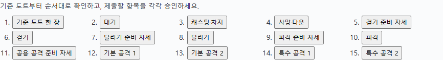

## 작업 결과

프로젝트 main에 96e15c0e를 푸시했습니다.

## 변경 내용

### 적용 내용

## 검증

Chrome에서 동일 스타일, 15개 항목 목록, 기존 부분 선택 및 모의 승인 요청을 확인했습니다.

## 남은 사항

공개 페이지 반영 미확인.

## 작업 시간

- 제안 시간: 3~5분
- 실제로 완료된 시간: 2026-11-21 21:04:29~21:05:35 KST, 1분 6초
- XERJ: 미사용 — 로컬 Chrome과 Git으로 확인했습니다.
