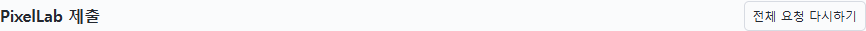

## 작업 결과

프로젝트 main에 40842430을 푸시했습니다.

## 변경 내용

### 적용 내용

## 검증

Chrome에서 PixelLab 헤더, 전체 목록의 모의 요청, 캐릭터 제작 부분 요청 표시를 확인했습니다.

## 남은 사항

공개 페이지 반영 미확인.

## 작업 시간

- 제안 시간: 별도 제안 없음
- 실제로 완료된 시간: 2026-11-21 21:07:07~21:07:51 KST, 44초
- XERJ: 미사용 — 로컬 Chrome과 Git으로 확인했습니다.
