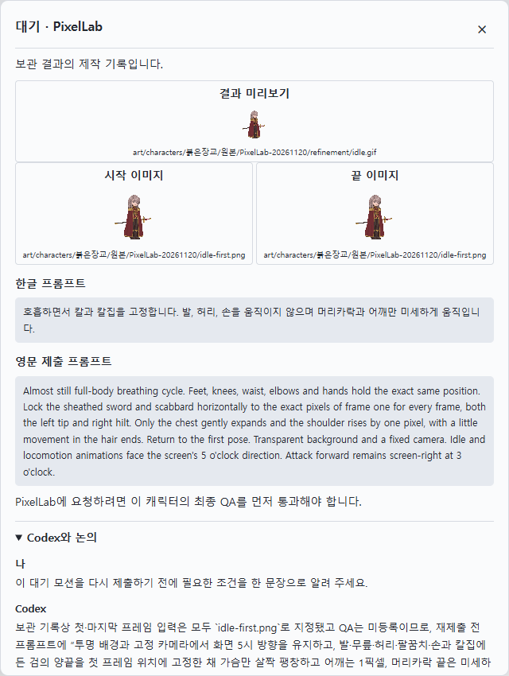

## 작업 결과

프로젝트 main에 70427ac0을 푸시하고 로컬 제작 현황 서버를 갱신했습니다.

## 변경 내용

### 적용 내용

## 검증

로컬 Chrome에서 붉은 장교 대기의 실제 한글 답변과 × 닫기를 확인했습니다. 모의 응답으로 후속 질문 문맥도 확인했습니다. PixelLab은 제출하지 않았습니다.

## 남은 사항

공개 페이지 반영 미확인. 대화 기록은 열린 페이지에 유지됩니다.

## 작업 시간

- 제안 시간: 4~7분
- 실제로 완료된 시간: 2026-11-21 21:09:21~21:13:57 KST, 4분 36초
- XERJ: 미사용 — 로컬 Chrome, Codex CLI 및 Git으로 확인했습니다.
