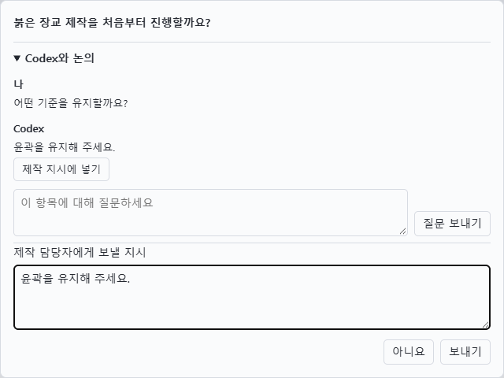
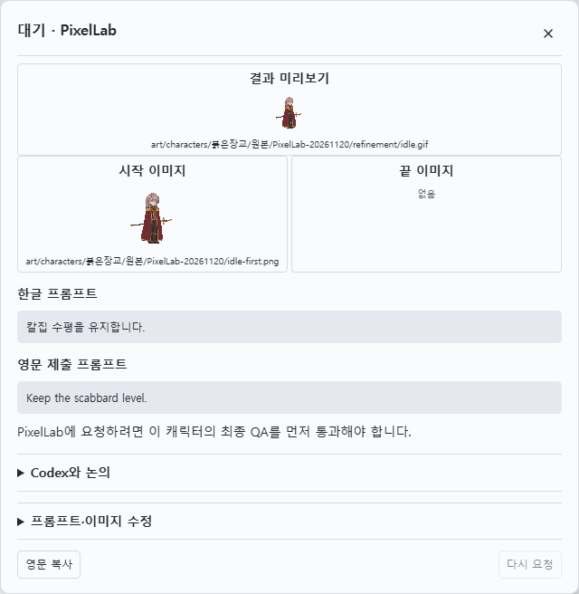

## 작업 결과

main에 8cbf2a43을 푸시하고 로컬 대시보드 서버를 갱신했습니다.

## 변경 내용

### 적용 내용

PixelLab 상단 전체 요청과 목록을 제거했습니다.

## 검증

Chrome의 모의 응답으로 전체·부분 요청 및 초안 갱신을 검증했습니다. 임시 데이터에서 PNG 해시, 승인 입력 스냅샷, 제작 지시 기록, 쓰기 충돌 방지를 확인했습니다. 실제 제작 및 PixelLab 제출은 없었습니다.

## 남은 사항

공개 페이지 반영 미확인.

## 작업 시간

- 제안 시간: 별도 제안 없음
- 실제로 완료된 시간: 2026-11-21 21:15:54~21:21:47 KST, 5분 53초
- XERJ: 미사용 — 로컬 Chrome, Node 및 Git으로 확인했습니다.
