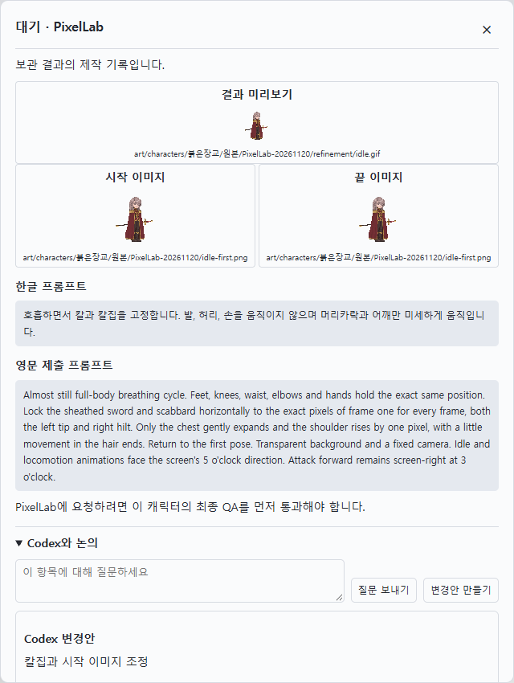
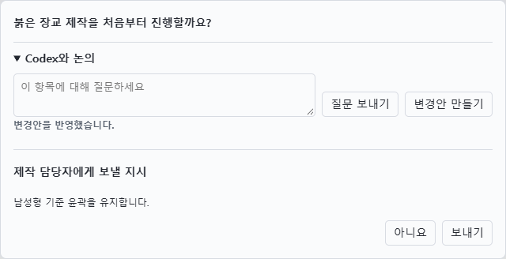

## 작업 결과

main에 cf65a00b를 푸시하고 로컬 대시보드 서버를 갱신했습니다.

## 변경 내용

### 적용 내용

## 검증

실제 Codex API에서 한글·영문 변경안 반환을 확인했습니다. Chrome에서는 모의 응답으로 이미지 미리보기, 반영 전 상태 유지, 카드 갱신과 확정 지시 전송을 확인했습니다. 실제 제작과 PixelLab 제출은 없었습니다.

## 남은 사항

공개 페이지 반영 미확인.

## 작업 시간

- 제안 시간: 5~8분
- 실제로 완료된 시간: 2026-11-21 21:24:14~21:27:47 KST, 3분 33초
- XERJ: 미사용 — 로컬 Chrome, Codex CLI 및 Git으로 확인했습니다.
