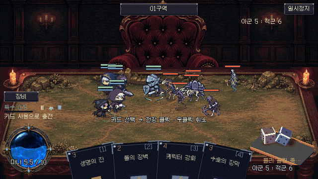

## 작업 결과

아군이 어느 적을 공격하든 실제로 체력을 깎은 직접 타격마다 공용 콤보가 1씩 오릅니다.

## 변경 내용

### 적용 내용

기본 공격과 스킬의 직접 타격을 집계하고, 아군 소환수도 포함했습니다. 카드 자체 피해와 지속 피해는 집계에서 제외했습니다. 카드 조준 중에도 콤보는 2초 기준으로 유지됩니다.

## 검증

Godot 4.7.2에서 5대6 전투에 진입했습니다. 실제 공격으로 우측 콤보가 1에서 7까지 올랐습니다. 추가 공격을 멈춘 캡처에서는 마지막 명중 약 2.02초 뒤 카운트가 0이 되고 표시가 사라졌습니다. GIF 43프레임을 확인했습니다. 프로젝트 main에 42d41b42를 푸시했습니다.

## 남은 사항

별도 배포 빌드는 미확인입니다.

## 작업 시간

- 제안 시간: 8분
- 실제로 완료된 시간: 2026-11-21 21:27~21:31 KST, 약 4분
- XERJ: 미사용 — Godot 렌더링과 콤보 변경 로그를 대조했습니다.
