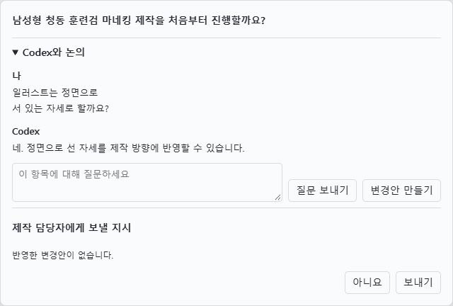

## 작업 결과

main에 940b31b0을 푸시했습니다.

## 변경 내용

### 적용 내용

## 검증

Chrome에서 모의 답변으로 Enter 전송, Shift+Enter 줄바꿈, 빈 입력 및 한글 조합 Enter의 미전송을 확인했습니다.

## 남은 사항

공개 페이지 반영 미확인.

## 작업 시간

- 제안 시간: 별도 제안 없음
- 실제로 완료된 시간: 2026-11-21 21:34:51~21:35:36 KST, 45초
- XERJ: 미사용 — 로컬 Chrome 및 Git으로 확인했습니다.
