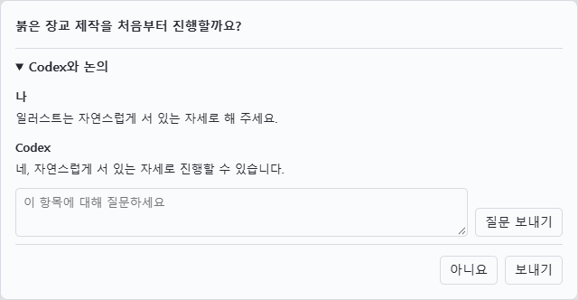

## 작업 결과

main에 8131e0dc를 푸시하고 로컬 서버를 갱신했습니다.

## 변경 내용

### 적용 내용

## 검증

Chrome에서 변경안 버튼 미표시와 양쪽의 대화 및 입력 중인 지시가 요청에 들어가는 것을 모의 검증했습니다.

## 남은 사항

공개 페이지 반영 미확인.

## 작업 시간

- 제안 시간: 별도 제안 없음
- 실제로 완료된 시간: 2026-11-21 21:36:52~21:37:55 KST, 약 1분
- XERJ: 미사용 — 로컬 Chrome 및 Git으로 확인했습니다.
