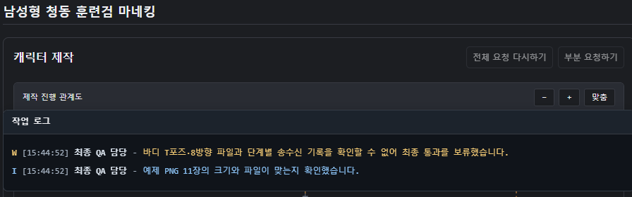

## 작업 결과

main에 5a2b31a0을 푸시했습니다.

## 변경 내용

### 적용 내용

## 검증

Chrome의 넓은 화면과 좁은 화면에서 로그 위치를 확인했고 위아래 스크롤을 캡처했습니다.

## 남은 사항

공개 페이지 반영 미확인.

## 작업 시간

- 제안 시간: 3~5분
- 실제로 완료된 시간: 2026-11-21 21:54:25~21:55:43 KST, 1분 18초
- XERJ: 미사용 — 로컬 Chrome 및 Git으로 확인했습니다.
