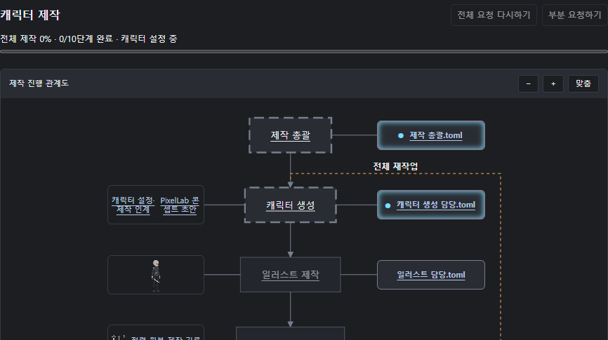

## 작업 결과

main에 ff41f679를 푸시했습니다.

## 변경 내용

### 적용 내용

## 검증

동작 감소를 켠 로컬 Chrome에서 모의 진행률 0→10%, 테두리 애니메이션, 활성 단계 전환 및 부분 요청 완료 수를 확인했습니다.

## 남은 사항

실제 진행 중인 제작은 변경하지 않았습니다. 공개 페이지 반영 미확인.

## 작업 시간

- 제안 시간: 별도 제안 없음
- 실제로 완료된 시간: 2026-11-21 21:56:23~21:58:41 KST, 2분 18초
- XERJ: 미사용 — 로컬 Chrome 및 Git으로 확인했습니다.
